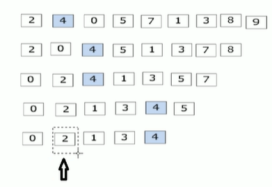
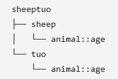
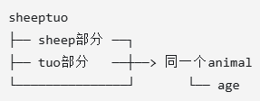
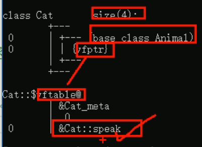
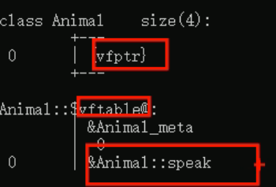
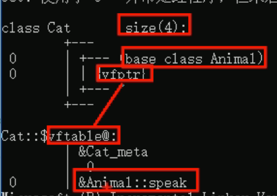

- [数据类型](#数据类型)
- [运算符](#运算符)
- [程序结构](#程序结构)
- [数组](#数组)
- [函数](#函数)
- [指针](#指针)
- [结构体](#结构体)
- [内存](#内存)
  - [new](#new)
- [引用(给变量起别名)](#引用给变量起别名)
- [函数高级](#函数高级)
  - [函数的默认参数](#函数的默认参数)
  - [函数的占位参数](#函数的占位参数)
  - [函数重载](#函数重载)
- [类\&对象](#类对象)
  - [封装](#封装)
  - [对象](#对象)
    - [构造函数与析构函数](#构造函数与析构函数)
    - [初始化列表:构造函数()：属性1(值1),属性2(值2)...{}](#初始化列表构造函数属性1值1属性2值2)
    - [类对象作为类成员](#类对象作为类成员)
    - [静态成员](#静态成员)
    - [成员函数和成员变量是分开存储的](#成员函数和成员变量是分开存储的)
    - [this指针(解决名称冲突/返回对象本身)](#this指针解决名称冲突返回对象本身)
    - [空指针调用成员函数](#空指针调用成员函数)
    - [const修饰成员函数](#const修饰成员函数)
  - [友元](#友元)
  - [运算符重载](#运算符重载)
    - [一：加号运算符重载](#一加号运算符重载)
    - [二：左移运算符重载](#二左移运算符重载)
    - [三：递增运算符重载](#三递增运算符重载)
    - [四：赋值运算符重载](#四赋值运算符重载)
    - [五：关系运算符重载](#五关系运算符重载)
    - [六：函数调用运算符重载(仿函数)](#六函数调用运算符重载仿函数)
  - [继承](#继承)
    - [一：继承基本语法](#一继承基本语法)
    - [二：继承方式](#二继承方式)
    - [三：继承中的对象模型](#三继承中的对象模型)
    - [四：构造和析构顺序](#四构造和析构顺序)
    - [五：同名成员处理](#五同名成员处理)
    - [六：同名静态成员处理](#六同名静态成员处理)
    - [七：多继承](#七多继承)
    - [八：菱形继承](#八菱形继承)
  - [多态](#多态)
    - [一：概念及语法](#一概念及语法)
    - [二：多态原理](#二多态原理)
    - [三：多态案列](#三多态案列)
    - [四：纯虚函数和抽象类](#四纯虚函数和抽象类)
    - [五：虚析构和纯虚析构](#五虚析构和纯虚析构)
- [文件操作](#文件操作)
  - [文本文件](#文本文件)
    - [一：写文件](#一写文件)
    - [二：读文件](#二读文件)
  - [二进制文件](#二进制文件)
    - [一：写文件](#一写文件-1)
    - [二：读文件](#二读文件-1)
- [职工管理系统](#职工管理系统)
  - [一：add()](#一add)
  - [二：save()](#二save)
  - [三：get\_num()](#三get_num)
  - [四：show()](#四show)
  - [五：dele()](#五dele)
  - [六：modify()  **重要**](#六modify--重要)
  - [七：search()](#七search)
  - [八：sort()](#八sort)
  - [九：clear()](#九clear)
  - [十：构造函数](#十构造函数)
  - [十一：析构函数](#十一析构函数)
  - [十二：Worker类](#十二worker类)
  - [十三：workerManner](#十三workermanner)
  - [十四：补充](#十四补充)
- [模板](#模板)
  - [函数模版](#函数模版)
    - [一：基本语法](#一基本语法)
    - [二：普通函数与模版函数区别](#二普通函数与模版函数区别)
    - [三：普通函数与模版的调用规则](#三普通函数与模版的调用规则)
    - [四：模板局限性](#四模板局限性)
  - [类模板](#类模板)
    - [一：基本语法](#一基本语法-1)
    - [二：类模板对象做函数参数](#二类模板对象做函数参数)
    - [三：类模板与继承](#三类模板与继承)
    - [四：类模板成员函数类外实现](#四类模板成员函数类外实现)
    - [五：类模板分文件编写](#五类模板分文件编写)
    - [六：类模板与友元](#六类模板与友元)
  - [案例](#案例)
- [STL](#stl)
  - [vector](#vector)
    - [一：基本语法](#一基本语法-2)
    - [二：容器中存放自定义数据类型](#二容器中存放自定义数据类型)
    - [三：vector容器中嵌套vector容器](#三vector容器中嵌套vector容器)
    - [四：vector的构造函数](#四vector的构造函数)
    - [五：vector赋值操作](#五vector赋值操作)
    - [六：vector容量和大小](#六vector容量和大小)
    - [七：vector插入和删除](#七vector插入和删除)
    - [八：vector数据存取](#八vector数据存取)
    - [九：互换容器](#九互换容器)
    - [十：预留空间](#十预留空间)
  - [string](#string)
    - [一：string构造函数](#一string构造函数)
    - [二：string赋值操作](#二string赋值操作)
    - [三：string字符串拼接](#三string字符串拼接)
    - [四：string查找与替换](#四string查找与替换)
    - [五：string字符串比较](#五string字符串比较)
    - [六：string字符串存取](#六string字符串存取)
    - [七：string字符串插入和删除](#七string字符串插入和删除)
    - [八：子串获取](#八子串获取)
  - [deque](#deque)
    - [deque构造函数](#deque构造函数)
    - [deque赋值操作](#deque赋值操作)
    - [deque大小](#deque大小)
    - [deque插入和删除](#deque插入和删除)
    - [deque数据存取](#deque数据存取)
    - [deque排序](#deque排序)
  - [案例](#案例-1)
  - [stack(栈)](#stack栈)
  - [queue(队)](#queue队)
  - [list(链表)](#list链表)
    - [list接口](#list接口)
      - [构造函数](#构造函数)
      - [赋值和交换](#赋值和交换)
      - [大小操作](#大小操作)
      - [插入删除](#插入删除)
      - [数据存取](#数据存取)
      - [反转和排序](#反转和排序)
      - [list案例：](#list案例)
  - [set/multiset](#setmultiset)
    - [set接口](#set接口)
      - [set构造和赋值](#set构造和赋值)
      - [set插入和删除](#set插入和删除)
      - [set大小和交换](#set大小和交换)
      - [set查找和统计](#set查找和统计)
      - [set和multiset区别](#set和multiset区别)
      - [pair对组创建](#pair对组创建)
      - [set容器排序](#set容器排序)
  - [map/multimap](#mapmultimap)
    - [map的特殊用法](#map的特殊用法)
    - [map接口](#map接口)
      - [map构造和赋值](#map构造和赋值)
      - [map插入和删除](#map插入和删除)
      - [map大小和交换](#map大小和交换)
      - [map查找和统计](#map查找和统计)
      - [map容器排序](#map容器排序)
    - [map/set补充](#mapset补充)
  - [STL函数对象](#stl函数对象)
    - [函数对象](#函数对象)
    - [谓词](#谓词)
    - [内建函数对象](#内建函数对象)
      - [算术仿函数](#算术仿函数)
      - [关系仿函数](#关系仿函数)
      - [逻辑仿函数](#逻辑仿函数)
  - [STL常用算法](#stl常用算法)
    - [遍历](#遍历)
      - [for\_each](#for_each)
      - [transform](#transform)
    - [查找](#查找)
      - [find](#find)
      - [find\_if](#find_if)
      - [adjacent\_find](#adjacent_find)
      - [binary\_search](#binary_search)
      - [count](#count)
      - [count\_if](#count_if)
    - [排序](#排序)
      - [sort](#sort)
      - [random\_shuffle](#random_shuffle)
      - [merge](#merge)
      - [reverse](#reverse)
    - [拷贝\&替换](#拷贝替换)
      - [copy](#copy)
      - [replace](#replace)
      - [replace\_if](#replace_if)
      - [swap](#swap)
    - [算术生成算法](#算术生成算法)
      - [accumulate](#accumulate)
      - [fill](#fill)
    - [集合算法](#集合算法)
      - [set\_intersection](#set_intersection)
      - [set\_union](#set_union)
      - [set\_difference](#set_difference)
  - [容器案例](#容器案例)
- [c++进阶补充](#c进阶补充)
  - [智能指针](#智能指针)
    - [unique\_ptr](#unique_ptr)
    - [shared\_ptr](#shared_ptr)
    - [shared\_ptr与unique\_ptr](#shared_ptr与unique_ptr)
    - [weak\_ptr](#weak_ptr)
  - [移动语义](#移动语义)
    - [左值](#左值)
    - [右值](#右值)
    - [移动语义](#移动语义-1)
  - [可调用对象function类](#可调用对象function类)
    - [函数指针](#函数指针)
    - [仿函数(函数对象)](#仿函数函数对象)
    - [Lambda表达式](#lambda表达式)
    - [std::function对象](#stdfunction对象)
    - [std::bind对象](#stdbind对象)


```text
生成目录 ctrl+shift+p Markdown: Create Table of Contents
更新目录 自动更新 或手动更新 ctrl+shift+p Markdown: Update Table of Contents
```

## 数据类型
内存占用
```cpp
short 2字节
int   4字节
long  win为4字节 linux为4字节(32位)和8字节(64位)
long long   8字节
float 4字节
double 8字节
char 1字节
```
sizeof()
```cpp
int a = 10;
cout << sizof(short) <<endl;
cout << sizeof(a) << endl;
```
定义
```cpp
float c = 1.11;//默认为double，此操作将c转为float
float d = 1.11f;

//科学计数法
float f1 = 3e2;//3*10^2
float f2 = 3e-3;//3*10^-3

char ch = 'a';//只能有一个字符，且只能用单引号
//字符型变量char 并不是把字符本身放到内存中存储，而是将对应的ASCII编码放入到存储单元 a-97 A-65
int ass = int(ch);//97

//字符串
char str[] = "hello";
//或
#include <string>
string str1 = "hello";

//布尔
bool flag = true;
//打印输出为1
cout <<flag << endl;
```
数据输入
```cpp
int a = 0;
cin >> a;
//输入bool型时，只接受数字，不接收true/false  
```
\n换行 \t水平制表 \\转义

## 运算符
前置++
```cpp
//先+1，后运算表达式
int a = 10;
int b = ++a;
cout << b << endl;//b = 11
```
后置++
```cpp
//先进行表达式运算，后+1
int a = 10;
int b = a++;
cout << b << endl;//b = 10
```

## 程序结构
 if
 ```cpp
if(a>b){
    cout << a;
}
 ```
 三目运算符
 ```cpp
int a = 10;
int b = 20;
int c = 0;
c = a>b ? a:b;
//a>b成立则c=a a>b不成立则c=b
 ```
 switch
 ```cpp
switch(){
    case 1:a++;break;
    case 2:a--;break;
    default:a=b;break;
}
//不加break的话，倘若case为2，会运行a-- 和 a=b。
//switch相比if 执行效率高
 ``` 
 while和do_while
```cpp
int num = 0; 
//do_while先执行一次循环语句再判断循环条件 且dowhile的while后要加一个;
do{
    cout << num << endl;
    num++;
}while(num<10);
//while
while(num<10){
    cout << num << endl;
    num++;
}
```
水仙花数
```cpp
# 1^3+5^3+3^3=153
#include <iostream>
using namespace std;

int main(){
    int a =100;
    do{
        int bai = a/100;
        int shi = a%100/10;// a/10%10
        int ge = a&10;
        if(bai*bai*bai+shi*shi*shi+ge*ge*ge == a){
            cout << a << endl;
        }
        a++;
    }while(a<1000);
}
```
for
```cpp
for(int i = 0;i<100;i++){
    
}
```
9x9
```cpp
for(int i = 1 ;i<10;i++){
    for(int j = 1;j<=i;j++){
        //cout <<i "*" j = i*j >> endl;
        cout <<i << " * " << j << " = " << i*j << endl;
    }
    cout << endl;
}
```
break 直接结束此层循环
```cpp
for (int i=0;i<100;i++){
    if(i=10){
        break;
    }
}
```
continue 跳过此次循环的剩余代码，进入下一轮循环
```cpp
for(int i=0;i<10;i++){
    for(int j=0;j<10;j++){
        if(j=5){
            continue;
        }
        cout <<i << endl;
    }
}
```
goto
```cpp
cout << "1"<< endl;
cout << "2"<< endl;
goto FLAG;
cout << "3"<< endl;
cout << "4"<< endl;
FLAG:
cout << "5"<< endl;
```
## 数组
定义
```cpp
int arr1[];
int arr2[10]={};
int arr3[]={1,2,3,4,5};
```
sizeof
```cpp
sizeof(arr1);//统计整个数组在内存中的长度
sizeof(arr1[0]);//首个元素的内存占用长度
sizeof(arr1)/sizeof(arr1[0]);//二者结合可知数组长度
cout<<arr1 << endl;//打印出数组的首地址
```
元素逆置
```cpp
//法一
int arr1[5] = {1,2,3,4,5};
int end = sizeof(arr1)/sizeof(arr1[0]);
int num1;
for(int i=0;i<(end/2);i++){
    num1 = arr1[i];
    arr1[i]=arr1[end-1-i];
    arr1[end-1-i]=num1;
}
for(int i=0;i<=(end-1);i++){
    cout<< arr1[i] << endl;
}

//法二
int arr2[5]={1,2,3,4,5}
int end2 = sizeof(arr1)/sizeof(arr1[0]);
int num2;
for(int i =0;i<end2;i++){
    num2 = arr2[i];
    arr2[i] = arr2[end2-1];
    arr2[end2-1] = num2;
    end2--;
}
for(int i=0;i<=(end2-1);i++){
    cout<< arr2[i] << endl;
}

//法三
int arr3[5] = {1,2,3,4,5};
int end3 = sizeof(arr3)/sizeof(arr3[0]) - 1;
int num3;
int len = sizeof(arr1)/sizeof(arr1[0]);
int start3 = 0;
while(start3<end3){
    num3 = arr3[start3];
    arr3[start3] = arr3[end3];
    arr3[end3] = num3;
    end3--;
    start3++;
}
for(int i=0;i<len;i++){
    cout << arr3[i];
}
```
冒泡排序



```text
排序总轮数 = 元素个数 - 1
每轮对比次数 = 元素个数 - 排序轮数 - 1
```
```cpp
int arr0[] = {5,0,6,3,7,1,8,9};
len = sizeof(arr0)/sizeof(arr0[0]);
int max;
for(int i=0;i<len-1;i++){
    for(int j=0;j<len-i-1;j++){
        if (arr0[j]>arr0[j+1]){
            max = arr0[j];
            arr0[j] = arr0[j+1];
            arr0[j+1] = max;
        }
    }
}
for(int i=0;i<len;i++){
    cout << arro[i];
}
```
二维数组
```cpp
 int arr[2][3] = {{1,2,3},{4,5,6}};//{1,2,3,4,5,6}也可以
 int arr1[][3] = {1,2,3,4,5,6,7,8,9};//行数可以省略，列数不可以省略
//遍历
for(int i=0;i<2;i++){ 
    for(int j=0;j<3;j++){
        cout << arr[i][j] << endl;
    }
}   
//取某个元素的首地址时需要加取址符 & 
cout << (int)&arr[0][0] << endl;
```
## 函数
程序从上往下读，如果函数定义在调用之后，那么需要提前声明
```cpp
#include <iostream>
using namespace std;

int max();

int main(){
    return 0;
}
int max(){
    return 0;
}
```
分文件编写函数
```text
建一个.h文件用于写声明
建一个cpp文件用于写定义  顶部引用头文件#include "swap.h"
```
## 指针
定义
```cpp
int a = 10;
int * p = &a; //32位win占4字节   64位win占8字节 不管是什么数据类型(int/float/double)
cout << p << " " << &a << endl;
```
解引用 *p -> p指向的数值
```cpp
int a = 100;
int * p = &a;
*p = 1000;
cout << a <<" " << *p << endl; 
```
空指针
```text
初始化指针变量
且空指针指向的内存无法访问
内存编号0~255为系统占用内存，不允许用户访问
```
```cpp
int *p = NULL;
```
野指针
```text
指针变量指向非法的内存空间，访问会出错
```
const
```cpp
//常量指针(修饰指针)  指针的指向可以更改，但指针指向的值不可更改
int a = 10;
int b = 20;
const int *p = &a;
p = &b;
//*p = 30;错误

//指针常量(修饰常量) 指针指向不可改，指向的值可以改
int a = 10;
int b = 20;
int * const p = &a;
*p = 30;
//p = &b;错误

//const既修饰指针也修饰常量   两个都不可以改
int a = 10;
int b = 20;
const int * const p = &a;
//p = &b;错误
//*p = 30;错误
```
指针访问数组元素
```cpp
int arr[10] = {1,2,3,4,5,6,7,8,9,10};
int *p = arr;
cout << "第一个元素为：" << arr[0] << endl;//1
cout << "利用指针访问第一个元素" << *p << endl;//1
p++;//让指针向后偏移四个字节(智能识别步长，若为char *p 则p++代表偏移一个字节)
cout << "利用指针访问第二个元素：" << *p << endl;//2
```  
指针遍历数组
```cpp
int arr[10] = {1,2,3,4,5,6,7,8,9,10};
int *p = arr;
for(int i = 0;i<10;i++){
    cout << *p << endl;
    p++;
}
```
指针和函数
```cpp
//值传递不会改变实参数据
//地址传递可以实现改变实参数据
void swap(int *p1,int *p2){
    int temp = *p1;
    *p1 = *p2; 
    *p2 = temp;
    cout << *p1 << *p2 << endl;// 20 10
}
int main(){
    int a = 10;
    int b = 20;
    swap(&a,&b);
    cout << a << b << endl;//20 10
}
```
## 结构体
定义
```cpp
#include <iostream>
using namespace std;
#include <string> //cout << name

struct Student{
    string name;
    int age;
    int score;
}; // ;不要漏

int main(){
    struct Student s1;//创建结构体对象时，struct可以省略，即Student s1
    s1.name = "mike";
    s1.age = 11;
    s1.score = 100;
    cout << "name" << s1.name << "age" << s1.age << "score" << s1.score;
    
    struct Student s2 = {"jack",12,200};

} 
``
结构体数组
```cpp
struct Student{
    string name;
    int age;
    int score;
};

int main(){
    struct Student stuArray[]={
        {"mike",10,200},
        {"jack",21,130},
        {"lucy",30,90}
    };
    stuArray[2].name = "niko";

}
```
结构体指针
```cpp
struct Student{
    string name;
    int age;
    int score;
};

int main(){
    Student s = {"mike",11,100};
    Student *p = &s;//s是student型变量
    cout << p->name 
}
```
结构体嵌套结构体
```cpp
#include <iostream>
using namespace std;
#include <string> //cout << name

struct Student{
    int score;
    int age;
    string name;
};
struct Teacher{
    string name;
    int age;
    int id;
    Student stu;
};

int main(){
    Teacher t;
    t.id = 1001;
    t.age = 20;
    t.name = "mike";
    t.stu.name = "jack";
    t.stu.age = 10;
    t.stu.score = 100;
    cout << "teacher name:" << t.name << ", age:" << t.age << ", id:" << t.id << endl;
    cout << "stu.name:" << t.stu.name << ", stu.age:" << t.stu.age << ", stu.score:" << t.stu.score << endl;
}
```
结构体作为参数
```cpp
//值传递
void test1(struct student s){
    cout << s.name;
}

//地址传递
void test2(struct student *p){
    cout << p->name;
}

int main(){
    Student s1 = {"mike",11,200};
    test1(s1);
    test2(&s1);
}
```
const应用于结构体(常量指针)
```cpp
void test1(const Student *s){
      
}
//用常量指针每次只传递一个指针，仅4字节，而值传递则会复制整个结构体的数据过去。相比之下速度更快且能防止栈溢出
//相比于指针，常量指针不会改变实参的值
```
随机数
```cpp
#include <ctime>

srand((unsigned int)time(NULL));
int random = rand()%61+40//rand()%61 表0到60的随机数
```
## 内存
cpp程序运行时内存分区
```text
代码区 : 存放函数体的二进制代码  (共享 只读)   
全局区 : 存放全局变量、静态变量、常量
栈区 : 由编译器自动分配释放，存放函数的参数值，局部变量等 (不要返回局部变量的地址)
堆区 : 由程序员分配释放，若程序员不操作，程序结束时由操作系统回收
```
不要返回局部变量的地址
```cpp
int * func(){
    int a = 10;
    return &a;
}
int main(){
    int *p = func();
    cout << *p << endl;//第一次可以打印出正确的数字10
    cout << *p << endl;//第二次数据不再保留
}
```
利用new关键字，可以将数据开辟到堆区->可以返回局部变量的地址
```cpp
int * func(){
    int *p = new int(10);
    //new会返回开辟出的内存的地址(即返回new的类型的指针)，10代表将此数据赋初值
    return p; 
}
int main(){
    int *p = func();
    cout  << *p << endl;
    cout  << *p << endl;//均能成功返回数据10

}
```
### new
new的基本语法(new什么数据，就会返回个什么类型的指针)
```cpp
int * func(){
    int *p = new int(10);
    return p; 
}
void test1(){
    int *p = func();
    cout  << *p << endl;
    cout  << *p << endl;
    //堆区的数据由程序员管理开辟，程序员管理释放
    //释放堆区数据用delete
    delete p;
    cout  << *p << endl;//报错，内存已释放，无法访问
}
void test2(){
    //在堆区中new开辟数组
    new int[10];//10代表有10个元素，(10)代表赋初值10
    for(int i=0;i<10;i++){
        arr[i] = i+100;
    }
    for(int i=0;i<10;i++){
       cout << arr[i] <<endl;//可正常输出
    } 
    //释放堆区数组的内存,加上中括号
    delete[] arr;
    for(int i=0;i<10;i++){
       cout << arr[i] <<endl;//内存已释放，无法访问
    }

}
int main(){
    test1();
    test2();
}
```
## 引用(给变量起别名)
数据类型 &别名 = 原名
```cpp
int &b = a;
b = 20;
cout << a << endl;//输出20
//a，b操纵的是同一片内存
```
注意事项
```cpp
//引用必须要初始化
int &b;//错误示范
int &b = a;

//引用一旦初始化便不可更改
int a = 10;
int &b = a;
int c = 20;
&b = c;//错误示范
b = c;//仅赋值操作而非更改引用
```
引用做函数参数
```cpp
//形参修饰实参有两种方法，一种是地址传递，一种是引用传递
void swap1(int &a,int &b){//与swap1(int *a,int *b) 做区分
    //此处的ab是实参ab的别名，实际上就是指向实参ab的地址
    int temp = a;
    a = b;
    b = temp;    
}
int  main(){
    int a = 10;
    int b = 20;
    swap1(a,b);
    cout << a << endl;
    cout << b << endl；//成功交换
}
```
引用做函数返回值
```cpp
//不要返回局部变量的引用(和不要返回局部变量的地址原理一样，即函数运行完就释放局部变量的内存)
int& test1(){
    int a = 10;
    return a;
}  
int& test2(){
    static int a = 10;//静态变量，存在全局区，全局区上的数据等程序结束后再释放
    return a;
}
int main(){
    a1 = test1();
    cout << a1 << endl;//10
    cout << a1 << endl;//无结果
    a2 = test2();
    cout << a2 << endl;//20
    cout << a2 << endl;//20
    //函数的调用可以作为左值
    a3 = test2() = 1000;
    cout << a3 << endl;//1000
    cout << a3 << endl;//1000
} 
```
引用本质 相当于一个常量指针
```cpp
    int a =10;
    
    int * const ref = &a;
    等价
    int& ref = a;
```
const修饰引用--防止误操作
```cpp
void  showValue(int &val){
    val = 1000;
    cout << val << ednl;
}
void showValue1(const int &val){//加上const 对val的修改操作便是违法行为
    cout <<  val << ednl;
}
int main(){
    int a = 100;
    showValue(a);//函数内修改val，指向同一片内存，a也被修改为1000
    showValue1(a);
    cout<< a<< endl;
}
```
```cpp
int main(){
    int& ref = 10;//编译错误
    const int& ref = 10;//编译器优化代码，int temp = 10;  const  int& ref = temp;
}
```
## 函数高级
### 函数的默认参数
默认参数必须放在最后。如果自己传入数据，那么就用自己的数据，如果没有传入数据，那么就用默认值。
```cpp
如 int func(int a,int b = 1,int c){} //错误
   int func(int a ,in b = 1, int c = 2){} //正确
```
```cpp
int sum(int a,int b,int c=1){
    return a+b+c;
}
int main(){
    int a = 1;
    int b = 2;
    int c = 3;
    sum = sum(a,b,c);  //结果为6
    sum1 = sum(a,b);  //结果为4
}
``` 
如果函数声明有默认参数，函数实现就不能有默认参数(二选一)
```cpp
int func(int a=10,int b=20);
int func(int a=10,int b=20){//报错，重新定义了默认参数
    return a+b;
}
```
### 函数的占位参数
占位了必须传对应的数据，但传过来的数据暂时用不到
```cpp
void func(int a,int){
    pass;
}
int main(){
    func(10,20);
}
```
占位参数可以有默认参数
```cpp
void func(int a,int = 20){
    pass;
}
int main(){
    func(10);
}
```
### 函数重载
函数名可以相同，以提高复用性
```text
条件 均要满足
一:同一个作用域下
二:函数名称相同
三:函数参数类型不同，或个数不同，或顺序不同
```
```cpp
void func(){
    cout << "1" << endl;
}
void func(int a){
    cout << "2" << endl;
}
int main(){
    func();
    func(1);
}
```
函数的返回值不可以作为函数重载的条件
```cpp
//错误示范
void func(){
    cout << "1" << endl;
}
int func(){//仅返回值不同不满足条件
    cout << "2" << endl;
}
int main(){
    func();//1
    func(1);//2
}
```
引用作为重载的条件
```cpp
void func(int &a){
    cout << "1" << endl;
}
void func(const int &a){
    cout << "2" << endl;
}
int main(){
    int a =10;
    func(a);//a是变量,打印1
    func(10);//打印2
}
```
函数重载遇到默认参数
```cpp
void func(int a,int b=10){
     cout << "1" << endl;
}
void func(int a){
    cout << "2" << endl;
}
int main(){
    func(10);//这样调用错误，两个func都能调用
    //故避免这种情况发生
    func(10,20);//可成功调用，意味着第二个func()调用不了
}
```
## 类&对象
### 封装
属性和行为作为整体，即变量和函数
```text
类中的属性和行为，统一称为成员
属性：成员属性/成员变量
行为：成员函数/成员方法
```
```cpp
class Circle {

public:

    int m_r;
    
    double calculate1() {
        return 2 * (3.14) * m_r;
    }
};

int main() {
    Circle c1;
    c1.m_r = 10;
    cout << "周长" << c1.calculate1() << endl;
}
```
```cpp
class student {

public:
    string name;
    int id;

    void set() {
        cin >> name;//cin << this->name
        cin >> id;//cin << this->id
    }
    string printname() {
        return name;
    }
    int printid() {
        return id;
    }

};


int main() {
    student s1;
    s1.set();
    cout << s1.printid() << endl;
    cout << s1.printname() << endl;
}
```
访问权限
```text
public 公共--成员 类内可以访问，类外也可以访问
private 私有--成员 类内可以访问，类外不可以访问(子类不可以访问父类中的private内容)
protected 保护--成员 类内可以访问，类外不可以访问(子类可以访问父类中的protected内容)

私有成员通常由构造函数初始化，再通过公共成员函数读取或修改
```
class与struct区别
```text
默认的访问权限不同

struct中默认为public
class 中默认为private
```
在开发中，一般将成员属性设为私有，而成员函数设为公有
```text
优点1：将所有成员属性设为私有，可以自己控制读写权限(自己设置读写的接口)
优点2：对于写权限，可以检测数据的有效性
```
```cpp
class student {

private:
    string my_name;
    int my_id = 10;

public:
    void setname(string name) {
        my_name = name;
    }
    string printname() {
        return my_name;
    }
    int printid() {
        return my_id;
    }

};


int main() {
    student s1;
    s1.setname("mike");//用了公有的写接口
    //s1.my_id = 30;//报错，无法访问私有变量，即只读不写
    //cout << s1.my_id << endl;//没用公有的读接口，无法访问
    cout << s1.printname() << endl;//用了公有的读接口
    cout << s1.printid() << endl;//用了公有的读接口
}
```
封装案例

 [package_test.cpp 源码](./package_test.cpp)

 [package_test1.cpp 源码](./package_test1.cpp)

 ### 对象
 #### 构造函数与析构函数
    构造函数
 ```text
类名(){}
没有返回值也不写void
函数名称与类名相同
构造函数可以有参数因此可以发生重载
程序在调用对象时会自动调用构造，无需手动调用，且只会调用一次
 ```
    析构函数
 ```text
~类名(){}
没有返回值也不写void
函数名称与类名相同，在名称前加上~
析构函数无参数，因此不可以重载
程序在对象销毁前会自动调用析构，无需手动调用，且只会调用一次 
```
```cpp
#include <iostream>
using namespace std;
#include <string>

class Person {
public:
    Person() {
        cout << "构造函数调用" << endl;
    }
    ~Person() {
        cout << "析构函数调用" << endl;
    }
};
int main() {
    Person p;//自动调用构造和析构函数
    //如果自己不提供，那么编译器会提供一个空实现的构造和析构函数
    //对象被销毁才会运行析构函数
    system("pause");
    return 0;
}
```
    构造函数的分类
```text
按参数分类：有参构造和无参构造
按类型分类：普通构造和拷贝构造
```
    三种调用方式
```texts
括号法
显示法
隐式转换法
```
```cpp
#include <iostream>
using namespace std;
#include <string>

class Person {
public:
    //构造函数
    Person() {
        cout << "无参(默认)构造函数" << endl;
    }
    Person(int a) {
        age = a;
        cout << "有参构造函数" << endl;
    }

    Person(const Person& p) {//const保证不修改原对象，且以引用的方式传递
        age = p.age;//将传入的对象的所有属性拷贝到自己身上
        cout << "拷贝构造函数" << endl;
    }
    ~Person() {
        cout << "析构函数" << age << endl;
    }
private:
    int age;
};


int main() {
    //括号法
    Person p1;//不要写成Person p1(); 会被视作一个函数声明
    Person p2(10);
    Person p3(p2);//p3拷贝p2的数据
    //创建p1——创建p2——创建p3——销毁p3——销毁p2——销毁p1，至于这个p1销毁时age=1则是由于无参，所以给的一个随机值

    //显式法
    Person p1;
    Person p2 = Person(10);
    Person p3 = Person(p2);
    //Person(10)、Person(p2)为匿名对象 
    //特点:当系统前行执行结束后，系统会立刻回收匿名对象
    Person(10);
    cout << "aa" << endl;
    //不要利用拷贝函数初始化匿名对象 如Person(p3) 等价于  Person(p3) == Person p3;

    //隐式转换法
    Person p4 = 10;//相当于Person p4 = Person(10) 有参构造
    Person p5 = p2;//同理
}

```
    拷贝构造函数调用时机
```text
使用一个已经创建完毕的对象来初始化一个新的对象
值传递的方式给函数参数传值
以值方式返回局部对象
```
    构造函数调用规则
```text
创建一个类，编译器自动生成三个函数(默认构造函数/析构函数/拷贝构造函数)
若用户自定义有参构造函数，c++不再提供默认无参构造函数，但会提供默认拷贝构造
若用户自定义拷贝构造函数，c++不再提供其他构造函数
```
    深拷贝和浅拷贝(面试常问)
```text
浅拷贝：简单的赋值拷贝操作(复制地址)
深拷贝：在堆区重新申请空间，进行拷贝操作(复制地址指向的数据，并创建新的内存)
```

```cpp
//自动生成拷贝函数
#include <iostream>
using namespace std;
#include <string>

class Person{
public:
    Person(int age,int height) {    
        m_age = age;
        m_height = new int(height);//new会返回开辟出内存的地址，即指定类型的指针，将数据开辟到堆区
        //析构函数主要作用：将堆区的数据进行释放
        cout << "有参构造函数" << endl;
    }
    ~Person(){
        if(m_height != NULL){
            delete m_height;
            m_height =  NULL;
        }
        cout << "析构函数调用" <<endl;
    }
    int m_age;
    int *m_height;
};
int main(){
    Person p1(18,160);
    Person p2(p1);//此处是拷贝重点
    cout<<p2.m_age<<endl;
    cout<<*p2.m_height<<endl;
}
//对于m_age,利用编译器提供的拷贝函数，会做浅拷贝操作，利用默认的拷贝构造函数，复制了地址m_height
//对于*m_height，仍然是浅拷贝操作，浅拷贝操作对于指针变量会有影响。更改p1.height，p2.height也会随之更改。还有重复释放的问题。
```
```text
浅拷贝会带来问题：堆区重复释放(相互影响)
解决:利用深拷贝解决(重新申请内存)
```
```cpp
class Person{
public:
    Person(int age,int height) {
        m_age = age;
        m_height = new int(height);
        cout << "有参构造函数" << endl;
    }
    ~Person(){
        if(m_height != NULL){
            delete m_height;
            m_height =  NULL;
        }
        cout << "析构函数调用" <<endl;
    }
    Person(const Person &p){//自定义拷贝构造函数，new一个地址给p2.m_height
        cout << "拷贝函数调用" << endl;
        m_age = p.m_age;
        //m_height = p.m_height;浅拷贝操作(复制地址，共享一个整数)
        //m_height = p.m_height;编译器默认实现此行代码
        //深拷贝操作，解决浅拷贝带来的问题
        m_height = new int(*p.m_height);//深拷贝操作(复制整数，新建独立内存)
    }
    int m_age;
    int *m_height;
};  
```
#### 初始化列表:构造函数()：属性1(值1),属性2(值2)...{}
```cpp
class Person{
public:
    //传统的创建对象时就赋初值
    //Person(int a,int b,int c){
    //    m_a = a;
    //    m_b = b;
    //    m_c = c;
    //}

    //初始化列表赋初值
    Person() :m_a(10),m_b(20),m_c(30){
        
    }

    //改进版初始化列表赋值
    Person(int a,int b,int c):m_a(a),m_b(b),m_c(c){
        
    }

//private:
    int m_a;
    int m_b;
    int m_c;
};
void test1(){
    //Person p(10,20,30);

    //Person p;
    
    Person p(30,20,10);
    
    cout << p.m_a<<endl;
    cout << p.m_b<<endl;
    cout << p.m_c<<endl;
}

int main(){
   test1();
}
```
#### 类对象作为类成员
```cpp
//先构造内部的类对象，即先构造phone对象，后构造person对象
//栈——>先进后出。先释放person对象，在释放phone对象
class phone{
public:
    phone(string pname){
        m_name = pname;
        cout << "phone构造函数" << endl;
    }
    ~phone(){
        cout<<"phone析构函数"<<endl;
    }

    string m_name;
};

class Person{
public:
    Person(string name,string pname):m_name(name),m_phone(pname){//m_phone(pname)等价于phone m_phone = pname,即初始化phone对象的m_name为pname
        cout << "person构造函数" << endl;
    }
    ~Person(){
        cout<<"person析构函数"<<endl;
    }

    string m_name;
    phone m_phone;
};

void test1(){
    Person p("mike","iphone");
    cout << p.m_name << "+" << p.m_phone.m_name << endl;
}
int main(){
    test1();
}
```
#### 静态成员
```text
静态成员变量
    所有对象共享同一份数据
    在编译阶段分配内存
    类内声明，类外初始化
    不属于某个对象,属于类，有两种访问方式(1:通过对象进行访问  2：通过类名进行访问)
静态成员函数
    所有对象共享同一个函数
    静态成员函数只能访问静态成员变量
        (类外调用私有静态变量一般用公共静态函数，因为静态变量不属于任何对象，若使用普通函数，还需要建立对象访问函数。)
```
```cpp
class person{
public: 
    int m_c;
    //类内声明，类外初始化
    static int m_a;

    static void func(){
        cout<<"静态函数调用"<<endl;
        m_a = 10;
        m_b = 20;
        //m_c = 30;静态函数无法访问非静态变量，因为要建立特定对象访问非静态变量
    }
private:
    static int m_b;//仅是声明
};

int person::m_a = 100;
int person::m_b = 200;//定义并赋初值，private运行静态成员在类外定义

void test1(){
    person p;
    cout << p.m_a<<endl;
    person p1;
    p1.m_a = 23;
    cout << p.m_a<<endl;
}

void test2(){
    person p2;
    cout << p2.m_a << endl;//通过对象访问静态变量
    cout << person::m_a << endl;//通过类名访问静态变量 ** 推荐
    //cout << person::m_b << endl;类外无法直接访问私有成员变量
}

void test3(){
    person p3;
    p3.func();//通过对象调用
    person::func();//通过类名调用 ** 推荐
}

int main(){
    test1();
    test2();
    test3();
}
```
#### 成员函数和成员变量是分开存储的
```cpp
class Person{

};

class student{
    int m_a;//***非静态成员变量，属于类的对象上
    static int m_b;//静态成员变量，不属于类的对象上
    void func(){}//非静态成员函数，也不属于类的对象上
    static void func1(){}//静态成员函数，也不属于类的对象上
};

void test1(){
    Person p;//***空对象占用内存空间为1，c++编译器会给空对象也分配一个字节的空间，目的是为了区分空对象占内存的位置
    cout << "sizeof(p)=" << sizeof(p) << endl;//1字节
    student s;
    cout << "sizeof(s)=" << sizeof(s) << endl;//4字节,静态变量不属于类的对象上
}

int main(){
    test1();
}
```
#### this指针(解决名称冲突/返回对象本身)
```cpp
//错误示范
class person{
public:
    person(int age){
        age = age;//此处三个age由于重名，被视作为一个age变量
    }
    int age;
};

void test1(){
    person p1(18);
    cout << p1.age << endl;//乱码
}

int main(){
    test1();
}
```
```cpp
//解决办法(m_age/this->age)   解决名称冲突
class person{
public:
    person(int age){
        this->age = age;//this指向的是被调用的成员函数所属的对象，this->age指此类的成员变量age而非形参
    }
    int age;
};

void test1(){
    person p1(18);
    cout << p1.age << endl;
}

int main(){
    test1();
}
```
```cpp
//*this实现返回对象本身
class person{
public:
    person(int age){
        this->age = age;//this指向的是被调用的成员函数所属的对象，this.age指此类的成员变量age而非形参
    }
    int age;
    person& personaddage(person &p){//注意返回值类型是person&,如果写成了person，返回的只是p4的一个副本，后面做的两次都只是基于副本加1，并未改变原变量实际值
    //person  personaddage(...) // 返回副本(值)
    //person& personaddage(...) // 返回原对象(引用)
        this->age += p.age;
        return *this;
    }
};

void test2(){
    person p2(20);
    person p3(40);
    person p4(10);
    person p5(1);
    cout << p3.age << endl;
    p3.personaddage(p2);
    cout << p3.age << endl;
    cout << p4.age << endl;
    p4.personaddage(p5).personaddage(p5).personaddage(p5);//链式编程
    cout << p4.age << endl;
}

int main(){
    test2();
}

```
#### 空指针调用成员函数
```text
空指针可以访问成员函数
但涉及到this时，会报错
```
```text
空指针调用非静态成员函数属于未定义行为，不允许这样使用。

show1() 没有访问对象的数据，在某些编译器和运行环境中可能碰巧正常输出，
但这不代表写法正确。

showage() 中的 age 等价于 this->age。
由于 p 是空指针，调用时 this 也是空指针，不存在一个真实的 person 对象，
因此无法读取该对象的 age，通常会导致程序崩溃。

if (this == nullptr) 虽然在某些情况下看起来能阻止访问，
但不能让空指针调用成员函数变成合法行为。
正确做法是在调用成员函数之前检查 p。
```
```cpp
class person{
public:
    void show1(){
        cout<<"1"<<endl;
    }
    void showage(){
        if(this == nullptr){
            return;//报错原因是因为指针为nullptr，而age属于对象
        }
        cout << age << endl;//age等价于this->age
    }
    int age=10;
};

void test(){
   person *p = nullptr;
   p->show1();
   p->showage();
}

int main(){
    test();
}
//对于空指针，尽量用nullptr。如func(NULL)可能匹配int，而func(nullptr)明确匹配int*
```
#### const修饰成员函数
```text
常函数
    成员函数加const后称之为常函数
    常含数不可以修改成员属性
    成员属性声明时加关键字mutable后，在常函数中依然可以修改
常对象
    声明对象前加const成为常对象
    常对象只能调用常函数
```
```cpp
class person{
public:
    void showperson()const{
        //m_a = 10;等价this->m_a=10;
        //常函数中的this相当于const *person const this(第一个const：不能通过this修改他所指对象的普通成员。第二个const：this自身不能改为指向另一个对象)，不能通过this修改普通成员变量
        this->m_b = 100;//定义时加mutable即可修改
        cout<<"1"<<endl;
    }
    void func(){

    }
    int m_a=0;
    mutable int m_b=0;
};
void test1(){
    person p;
    p.func();
    p.showperson();
}
//常对象
void test2(){
    const person p1;
    //p1.m_a = 200;常对象不能修改普通的成员变量
    p1.m_b = 200;//定义时加mutable即可修改
    
    p1.showperson();
    //p1.func();常对象只能调用常函数
}
int main(){
    test1();
    test2();
}
```
### 友元
关键字friend<br>
友元关系不继承、不传递
```text
全局函数做友元       friend void test1(Building *building);
类做友元             friend class goodfriend;
成员函数做友元       friend void goodfriend::visit();
```
全局函数做友元
```cpp
class Building{

    friend void test1(Building *building);
    //test1是Building的友元，可以访问Building的私有成员

public:
    string m_sittingroom;
    Building(){
        m_sittingroom = "客厅";
        m_bedroom = "卧室";
    }
private:
    string m_bedroom;
};


void test1(Building *building){
    cout<<"friend正在访问:" << building->m_sittingroom<<endl;
    cout<<"friend正在访问:" << building->m_bedroom<<endl;
}


void test2(){
    Building building;
    test1(&building);
}
int main(){
    test2();
}
```
类作友元
```cpp
class Building;

class goodfriend{
public:
    goodfriend();
    void visit();
    Building * building;//声明指针，并没有创建对象
    ~goodfriend(){//必须释放否则内存泄漏
        delete building;
    }
};

class Building{
    friend class goodfriend;
    //goodfriend是Building的friend
public:
    Building();
    string m_sittingroom;

private:
    string m_bedroom;
};
//类外写成员函数
Building::Building(){
    m_sittingroom = "客厅";
    m_bedroom = "卧室";
}
goodfriend::goodfriend(){
    //创建building对象
    building = new Building;
}

void goodfriend::visit(){
    cout << "friend正在访问" << building->m_sittingroom << endl;
    cout << "friend正在访问" << building->m_bedroom << endl;
}

void test1(){
    goodfriend g1;
    //创建一个goodfrined对象，而goodfriend类的构造方法中又创建了building对象，building类的构造方法中给building对象赋初值
    g1.visit();
}
int main(){
    test1();
}
```
成员函数作友元
```cpp
class Building;

class goodfriend{
public:
    goodfriend();
    void visit();//让visit可以访问Building中私有的成员
    void visit1();//让visit1不可以访问私有成员
    Building * building;
    ~goodfriend(){//释放堆区内存
        delete building;
    }
};

class Building{
    friend void goodfriend::visit();
public:
    Building();
    string m_sittingroom;

private:
    string m_bedroom;
};

//类外写成员函数
Building::Building(){
    m_sittingroom = "客厅";
    m_bedroom = "卧室";
}
goodfriend::goodfriend(){
    //创建building对象
    building = new Building;
}

void goodfriend::visit(){
    cout << "visit-friend正在访问" << building->m_sittingroom << endl;
    cout << "visit-friend正在访问" << building->m_bedroom << endl;
}
void goodfriend::visit1(){
    cout << "visit1-friend正在访问" << building->m_sittingroom << endl;
    //cout << "visit1-friend正在访问" << building->m_bedroom << endl;
}

void test1(){
    goodfriend g1;
    //创建一个goodfrined对象，而goodfriend类的构造方法中又创建了building对象，building类的构造方法中给building对象赋初值
    g1.visit();
    g1.visit1();
}
int main(){
    test1();
}
```
### 运算符重载
#### 一：加号运算符重载
```text
通过局部函数或者全局函数重载加号运算符
局部函数意思就是在类内定义一个函数，然后通过对象调用，如p1.test(p2)
全局函数是在类外定义一个函数，直接调用，如test(p1,p2)

运算符重载的意义:给运算符号一些新的定义，如person p3 = p1 + p2;
```
```cpp
class person {
public:
    int m_a;
    int m_b;
    person add1(person& p1) {//此处的p1为引用而非指针，指针是person *p1,故而后续引用数据采用p1.m_a而非p1->m_a
        person temp;
        temp.m_a = this->m_a + p1.m_a;
        temp.m_b = this->m_b + p1.m_b;
        return temp;
    }
};
person add2(person& p1, person& p2) {
    person temp;
    temp.m_a = p2.m_a + p1.m_a;
    temp.m_b = p2.m_b + p1.m_b;
    return temp;
}
void test1() {
    person p1;
    p1.m_a = 10;
    p1.m_b = 1;
    person p2;
    p2.m_a = 20;
    p2.m_b = 2;
    person p3;
    person p4;
    p3 = p1.add1(p2);
    p4 = add2(p1, p2);
    cout << p3.m_a << " " << p3.m_b << endl;
    cout << p4.m_a << " " << p4.m_b << endl;
}
int main() {
    test1();
    return 0;
}
```
改进版，用系统自带(operator+())
```cpp
//将重载的函数名改为
person operator+(person &p1){}
person operator+(person &p1,person &p2){}
//这样就可直接写
person p3 = p1 + p2;//本质是p3 = operator+(p1,p2)/p3 = p1.operator(p2)

//改成
person operator+(person &p1,num)
//即可实现
p3 = p1 + num;
```
示例
```cpp
//成员函数版本
class Person {
public:
    Person(int a, int b) : m_a(a), m_b(b) {}

    Person operator+(const Person& other) const {
        Person temp;

        temp.m_a = m_a + other.m_a;
        temp.m_b = m_b + other.m_b;

        return temp;
    }

    Person() = default;

    int m_a = 0;
    int m_b = 0;
};
void test(){
    Person p1(10, 1);
    Person p2(20, 2);
    Person p3 = p1 + p2;//Person p3 = p1.operator+(p2);
    //p1 是调用函数的对象，也就是 *this,左侧的 p1 已经通过 this 传入。
    //p2 传给参数 other
}
```
```cpp
//全局函数版本
Person operator+(const Person& p1, const Person& p2) {
    Person temp;

    temp.m_a = p1.m_a + p2.m_a;
    temp.m_b = p1.m_b + p2.m_b;

    return temp;
}
void test(){
   Person p3 = p1 + p2;//Person p3 = operator+(p1, p2);
}
```
#### 二：左移运算符重载
一般采用全局函数进行重载，重载左移运算符可以实现输出自定义数据类型
```cpp
class person{
friend ostream & operator<<(ostream &out,person &p);//声明友元函数，以访问private成员变量
public:
        void set(int a,int b){
            m_a = a;
            m_b = b;
        }    
private:
        int m_a;
        int m_b;
};

ostream & operator<<(ostream &out,person &p){//简化operator<<(cout，p)即cout<<p
    //cout是输出流对象(ostream对象)，p是person类对象
    out << "m_a:" << p.m_a << "m_b:" << p.m_b << endl;
    return out;//返回值处加&表示返回的是输出流对象本身，而不是新建一个ostream对象
    //若返回值是void，则无法实现cout<<p1<<endl的连续输出
}

int main(){
    person p1;
    p1.set(10,20);
    cout << p1 << "hello" << endl; 
    //operator<<(cout,p1); 二者均可
}

```
#### 三：递增运算符重载
前置递增返回引用，后置递增返回值。(如果返回临时变量temp的引用，那返回的是+1后的新值，而不是旧值)
```text
固定写法
person &operator++(){}      前置递增
person operator++(int){}    后置递增
```
```cpp
class person{
friend ostream & operator<<(ostream &out,const person &p);//声明友元函数
public:
        person(){
            m_num = 0;
        }  
//重载前置++运算符
        person &operator++(){//重载前置++运算符
            //先++运算
            m_num++;
            //再将自身返回
            return *this;
        }
//重载后置++运算符
        person operator++(int){//此处的形参int代表占位参数，用于区分前置和后置递增
           person temp = *this;//先将当前对象的值(旧值)保存到临时对象中
           m_num++;//再将当前对象的值加1
           return temp;//返回临时对象
        }
private:
        int m_num;
        
};

ostream & operator<<(ostream &out,const person &p){//const person &p表示传入的person对象是只读的，不能修改其成员变量,且可以接收临时对象和普通对象
    //简化operator<<(cout，p)即cout<<p
    //cout是输出流对象(ostream对象)，p是person类对象
    out << "m_num:" << p.m_num << endl;
    return out;//返回值处加&表示返回的是输出流对象本身，而不是新建一个ostream对象
    //若返回值是void，则无法实现cout<<p1<<endl的连续输出
}
void test1(){
    person p1;
    cout << ++(++p1) << endl;
    cout << p1 << endl;
    //若person operator++()，则输出为一个2一个1，每次++运算都会返回一个新的person对象，p1的m_num值不会改变
    //若person &operator++()，则输出为一个2一个2，每次++运算都会返回自身的引用，p1的m_num值会改变
    
}
void test2(){
    person p2;
    cout << (p2++)++ << endl;
    cout << p2 << endl;
}
int main(){
    //test1();
    test2();

    return 0;
}
```
#### 四：赋值运算符重载
```text
cpp编译器给一个类至少添加4个函数
1默认构造函数(无参，函数体为空)
2默认析构函数(无参，函数体为空)
3默认拷贝构造函数，对属性进行值拷贝
4赋值运算符operator=，对属性进行值拷贝

若类中有属性指向堆区，做赋值操作时也会出现深浅拷贝问题，导致堆区内存重复释放
编译器默认提供的=是浅拷贝操作，所以需要重载=，加入深拷贝
```
```cpp
class person {
public:
    person(int age) {
        my_age = new int(age);
    }
    // 深拷贝构造
    person(const person& p){
        my_age = new int(*p.my_age);
    }
    ~person() {
        if (my_age != nullptr) {
            delete my_age;
            my_age = nullptr;
        }
    }
    person& operator=(const person& p) {//若为person operator=(person& p),则是返回值，相当于按照自身调用拷贝构造函数创建一个新的副本，返回引用才是返回真正的自身。此外要加const，因为赋值时只读取右侧对象，不应该修改它。
        //编译器提供浅拷贝m_age = p.my_age;

        //应该先判断是否有属性在堆区，如果有先释放干净，然后再进行深拷贝
        if (my_age != nullptr) {
            delete my_age;
            my_age = nullptr;
        }    
        //深拷贝
        my_age = new int(*p.my_age);

        return *this;
        //由于是p2调用此函数，因此this指向的是p2本身，即*this就是p2，由于函数返回值类型是person&，所以return *this。如果函数返回值类型是person*，return this
    }

    int* my_age;
};

void test1() {
    person p1(18);
    person p2(20);
    person p3(30);
    //由于构造函数的存在，会执行三次new int,得到三块独立的内存分别用于存放 18 20 30
    //但由于p1 p2 p3是局部对象，通常位于栈上，
    //后续进行深拷贝，释放p2指向20的内存，新建一个内存空间，用于保存p2的18，p3同理，最后三个值都是18，但拥有三块独立的内存空间

    p2 = p1;
    p3 = p2 = p1;//此代码要求必须返回为person的引用，否则无法连续调用“ = ”
    //p3.operator=(p2.operator=(p1));
    cout << "p1 age: " << *p1.my_age << endl;
    cout << "p2 age: " << *p2.my_age << endl;
    cout << "p3 age: " << *p3.my_age << endl;
}

int main() {
    test1();
    return 0;
}
```
#### 五：关系运算符重载
    用于对比自定义数据类型
```cpp
class person {
public:
    person(string name, int age) {
        m_name = name;
        m_age = age;
    }

    //重载==运算符
    bool operator==(const person& p) const {//第一个const:不允许修改传入的p(即p2)。//第二个const:不允许修改函数调用者*this(即p1)
        if (this->m_name == p.m_name && this->m_age == p.m_age) {
            return true;
        }
        else {
            return false;
        }
    }
    int m_age;
    string m_name;
};

void test1() {
    person p1("mike", 18);
    person p2("mike", 19);
    if (p1 == p2) {//p1==p2相当于p1.operator==(p2)
        cout << "p1==p2" << endl;
    }
    else {
        cout << "p1!=p2" << endl;
    }
}

int main() {
    test1();
    return 0;
}
```
#### 六：函数调用运算符重载(仿函数)
```text
对象(参数)  等价于   对象.operator()(参数)
由于重载后的方式非常像函数的调用，因此也成为仿函数
仿函数没有固定写法，非常灵活

仿函数相较于普通函数的优点：对象内部可以保存状态
```
```cpp
class mprint {
public:
    void operator()(const string& test) const{//重载()运算符
        cout << test << endl;
    }
};//仿函数很灵活，没有固定写法

class Madd {
public:
    int operator()(int a, int b) const {//重载()运算符
        return a + b;
    }
};//仿函数很灵活，没有固定写法
 
void m_print(string test) {
    cout << test << endl;
}

void test1() {
    mprint printer;
    printer("Hello World");//调用运算符重载，和函数调用非常像，又称仿函数
    //等价于printer.operator()("Hello World")
    m_print("Hello World");//函数
}

void test2() {
    Madd adder;
    cout << adder(1, 2) << endl;//仿函数
    //等价于adder.operator()(1,2)

    //Madd()(3,4)为匿名函数对象。匿名对象：当前行执行完立即被释放
    cout << Madd()(3, 4) << endl;
    //拆分为两步    Madd temp;(临时对象)     cout<<temp(3,4)<<endl; 
}
int main() {
    test1();
    test2();
    return 0;
}
```
### 继承
#### 一：继承基本语法
    class 子类:继承方式 父类
```text
减少重复代码
子类又称派生类
父类又称基类
```
```cpp
class father{

};
class son:public father{

};
```
#### 二：继承方式
```text
公共继承
保护继承
私有继承

public 公共--成员 类内可以访问，类外也可以访问
private 私有--成员 类内可以访问，类外不可以访问(子类不可以访问父类中的private内容)
protected 保护--成员 类内可以访问，类外不可以访问(子类可以访问父类中的protected内容)
```
伪代码示例
```cpp
class father{
    public:
        int a;
    protected:
        int b;
    private:
        int c;
};

class son1:public father{//public和protected保持不变
    public:
        int a;
    protected:
        int b;
    c无法访问
}
class son2:protected father{//publich和protected均变为protected
    protected:
        int a;
        int b;
    c无法访问
}
class son3:private father{//public和protected均变为private
    private:
        int a;
        int b;
    c无法访问
}

```
    代码示例
```cpp
class father{
    public:
        int a=10;
    protected:
        int b=20;
    private:
        int c=30;
};

class son1: public father{
    public:
        void show(){
            cout << "a = " << a << endl;
            cout << "b = " << b << endl;
            // cout << "c = " << c << endl; // private成员不能在子类中访问
        }
};
class son2: protected father{
    public:
        void show(){
            cout << "a = " << a << endl;
            cout << "b = " << b << endl;
            // cout << "c = " << c << endl; // private成员不能在子类中访问
        }
};
class son3: private father{
    public:
        void show(){
            cout << "a = " << a << endl;
            cout << "b = " << b << endl;
            // cout << "c = " << c << endl; // private成员不能在子类中访问
        }
};
void test(){
    son1 s1;
    son2 s2;
    son3 s3;
    s1.show();
    s2.show();
    s3.show();
}
void test1(){
    son1 s1;
    son2 s2;
    son3 s3;
    s1.a = 100; 
    //s1.b = 200;protected成员不能在类外访问
    //s2.a = 100;protected成员不能在类外访问
    //s2.b = 200;protected成员不能在类外访问
    //s3.a = 100;private成员不能在类外访问 
    //s3.b = 200;private成员不能在类外访问
    cout << "s1.a = " << s1.a << endl;

}
int main(){
    test();
    test1();
    return 0;
}
```
#### 三：继承中的对象模型
```cpp
class father {
public:
    int a = 10;
protected:
    int b = 20;
private:
    int c = 30;
};

class son :public father {

};

void test() {
    son s1;
    cout << sizeof(s1) << endl;
    //sizeof(s1) = 12.
    //父类中所有非静态成员属性都会被子类继承下去
    //父类中的private成员属性，也被继承了，但是被编译器隐藏了，因此访问不到
}
int main() {
    test();
    return 0;
}
//即s1下有三个变量，a,b,c
```
#### 四：构造和析构顺序
类似内容[跳转-类对象作为类成员](#类对象作为类成员)
```text
先有爹后有儿子
父类构造-子类构造-子类析构-父类析构
```
```cpp
class father {
public:
    father() {
        cout << "father constructor" << endl;
    }
    ~father() {
        cout << "father destructor" << endl;
    }
};
class son :public father {
public:
    son() {
        cout << "son constructor" << endl;
    }
    ~son() {
        cout << "son destructor" << endl;
    }
};
void test() {
    son s1;
}
int main() {
    test();
    return 0;
}
```
#### 五：同名成员处理
```text
当子类和父类中出现同名的成员
访问子类同名成员：直接访问即可
访问父类同名成员：需要加作用域 s1.father::a   s1.father::func()

成员变量或者成员函数同理
```
```cpp
class father {
public:
    int a = 10;
    void func() {
        cout << "111" << endl;
    }
    void func(int a) {
        cout << "333" << endl;
    }
};
class son :public father {
public:
    int a = 100;
    void func() {
        cout << "222" << endl;
    }

};
void test() {
    son s1;
    cout << s1.a << endl;
    cout << s1.father::a << endl;
    s1.func();
    s1.father::func();
    s1.father::func(1);
    //不可s1.func(1) 因为子类出现同名函数时，会隐藏掉父类中的同名函数，要想调用必须加作用域
}
int main() {
    test();
}
```
#### 六：同名静态成员处理
    与同名成员类似，只是多了通过类名访问
```cpp
class father {
public:
    static int a;
    static void func() {
        cout << "father-func" << endl;
    }
};
class son :public father {
public:
    static int a;
    static void func() {
        cout << "son-func" << endl;
    }
};

int father::a = 10;
int son::a = 20;

void test() {
    son s1;
    //通过对象访问
    cout << s1.father::a << endl;
    cout << s1.a << endl;
    s1.father::func();
    s1.func();

    //通过类名访问
    cout << father::a << endl;
    cout << son::a << endl;
    father::func();
    son::func();
    //通过子类与父类关系，用类名访问
    //第一个::代表通过类名方式访问，第二个::代表访问父类作用域下的成员变量
    cout << son::father::a << endl;//太绕了，直接写father::a    
    son::father::func();
}
int main() {
    test();
}
```
#### 七：多继承
    class 子类:继承方式 父类1,继承方式 父类2.......
```text
当多个父类中出现了同名的成员变量，调用时需要加作用域    
```
#### 八：菱形继承
    动物是羊 驼的父类，羊驼同时继承羊 驼
```text
动物的age变量，传给羊和驼，但是羊驼又同时继承了这两个类的age，事实上，羊驼只需要一个age.利用虚继承解决(类似静态变量)
其中animal称为虚基类
类似于静态变量，age只剩一个，因此无论是s1.age/s1.sheep::age/s1.tuo::age，指的都是同一个age(指向同一个内存)
从sheep和tuo下继承来的是vbptr(虚基类指针 virtual base ptr),指向vbtable(虚基类表)
```
```text
普通菱形继承：
每个 sheeptuo 对象中有两份 animal::age

虚继承：
每个 sheeptuo 对象中只有一份自己的 animal::age

static：
整个程序中所有 animal 相关对象共同使用一份 age

静态变量并不能代替虚继承解决问题，因为所有对象共用这一个信息，而虚继承能实现每个对象有自己特有的信息。
静态变量只能解决age重复的问题
```
         
```cpp
class animal {
public:
    int age;
};

class sheep :virtual public animal {

};
class tuo :virtual public animal {

};

class sheeptuo :public sheep, public tuo {

};
void test() {
    sheeptuo s1;
    s1.sheep::age = 10;
    s1.tuo::age = 20;
    cout << s1.sheep::age << endl;
    cout << s1.tuo::age << endl;
    cout << s1.age << endl;//虚继承特有

}
int main() {
    test();
}
```
### 多态
#### 一：概念及语法
多态是cpp面向对象三大特性之一
```text
分类
静态多态：函数重载和运算符重载属于静态多态，复用函数名
动态多态：派生类和虚函数实现运行时多态

区别
静态多态的函数地址早绑定-编译阶段确定函数地址
动态多态的函数地址晚绑定-运行阶段确定函数地址
```
```text
重写函数
    函数返回值类型，函数名，参数列表完全相同
    仅函数体不同
    与函数重载作区分
```
```cpp
class Animal {
public:
    virtual void speak() {
        cout << "animal-speak" << endl;
    }
};
class Cat :public Animal {
public:
    void speak() {
        cout << "miao" << endl;
    }
};
class Dog :public Animal {
public:
    void speak() {
        cout << "wang" << endl;
    }
};
//地址早绑定，在编译阶段确定函数地址
//想要让猫类运行dospeak函数，利用动态多态，函数地址晚绑定
//在函数名前加一个virtual即可   virtual void speak() 
void dospeak(Animal& animal) {//引用传递，若为值传递，则会失去多态
    animal.speak();
}
//动态多态满足条件
//    1有继承关系
//    2子类重写父类虚函数
//    3通过父类指针或引用调用虚函数

//动态多态的使用：父类的指针或引用，执行子类对象 Animal& animal = cat,切记不要使用值传递
//按值传递或赋值给父类对象会失去动态多态
//任何相关的传递都要考虑是用值传递还是引用传递还是地址传递
void test() {
    Cat cat;
    dospeak(cat);
    Dog dog;
    dospeak(dog);
}
int main() {
    test();
}
```
#### 二：多态原理
```cpp
class Animal{
public:
    void speak(){
        pass;
    }
};
//sizeof(Animal) = 1

class Animal{
public:
    virtual void speak(){//虚函数

    }
};
//sizeof(Animal) = 8 多了一个虚指针，在64位系统中大小为8
```

子类没有重写继承的虚函数时：
```text
        Animal 的虚函数表：
        └── speak → Animal::speak

        Cat 的虚函数表：
        └── speak → Animal::speak
```
虽然对象的实际类型是cat，但cat没有提供自己的实现，所以虚函数表中的speak项目仍指向Animal::speak()
```text
    Cat cat;
    Animal& animal = cat;
    animal.speak();
实际调用的是：
    Animal::speak()
```
子类重写继承的虚函数时：
```text
        Animal 的虚函数表：
        └── speak → Animal::speak

        Cat 的虚函数表：
        └── speak → Cat::speak
```
即cat对象的内部虚拟表指针指向Cat内部的虚函数表，此表中存放的是Cat::speak()的地址<br>
(通过 cat 对象的 vptr ——> 找到 Cat 虚函数表 ——> 找到 speak 对应的函数地址 ——> 调用 Cat::speak)<br>

**当父类指针或者引用指向子类对象的时候，发生多态**
```text
即:
    Cat cat;
    Animal & animal = cat;
    animal.speak();
```
animal调用speak()，会从Cat的虚拟表中找这个函数地址<br>
以下分别是重写过的Cat类、Animal类、未重写过的Cat类<br>
        <br>
#### 三：多态案列
引用和指针的部分区别<br>
-   调用其内部成员时，引用：b1.func() 指针：b1->func()
-   二者均可指向栈区或堆区
-   引用强调对象必须存在且绑定不变，而指针允许指向为空和改变指向<br>
-   指针和引用只是访问对象的方式<br>

二者均可指向栈区或堆区
```cpp
addCalculator add;
basicCalculator& ref = add;
basicCalculator* ptr = &add;
ref.getResult();
ptr->getResult();

basicCalculator* ptr1 = new addCalculator;
basicCalculator& ref1 = *(new addCalculator);
```
   
栈区和堆区区别<br>
-   栈区数据离开作用域会执行析构函数，自动销毁。堆区数据调用结束不会自动销毁，等待程序员操作，所以需要delete b1
-   栈区：person p1;  堆区：new person;
-   栈和堆决定对象的生命周期管理方式<br>

[duotai_1.cpp 示例](./duotai_1.cpp)<br>
[duotai_2.cpp 示例](./duotai_2.cpp)<br>
多态的优点<br>
-   组织结构清晰
-   可读性强
-   前期及后期的扩展和维护性高(对拓展开发，对修改关闭)
#### 四：纯虚函数和抽象类
在多态中，通常父类的虚函数的实现是没有意义的，主要都是调用子类重写的内容，因此可以改写为纯虚函数<br>
纯虚函数语法： virtual 返回值类型 函数名 (参数列表) = 0;如 **virtual void func() = 0;**<br>
类中有纯虚函数的类又称作抽象类<br>

抽象类特点：<br>
-  无法实例化对象
-  子类必须重写抽象类中的纯虚函数，否则子类也属于抽象类，无法实例化对象
-  但可以创建指针或引用(Animal* pointer;/Animal& reference = cat;)
-  抽象函数可以包含纯虚函数+普通函数
#### 五：虚析构和纯虚析构
二者均可解决父类指针释放子类对象问题。只要可能通过父类指针 delete 子类对象，父类析构函数就必须是虚函数，与子类有没有堆区成员无关<br>
且都需要有具体的函数实现(与纯虚函数不同，纯虚函数不需要函数实现)<br>        
```text
虚析构语法：
    virtual ~Animal(){函数实现}

纯虚析构语法
    virtual ~Animal() = 0;
    类外 Animal::~Animal(){函数实现}
```
```cpp
class Animal {
public:
    Animal() {
        cout << "Animal构造" << endl;
    }
    //virtual ~Animal() {
    //    cout << "Animal虚析构" << endl;
    //}
    virtual ~Animal() = 0;
    virtual void speak() = 0;
    string* m_name;
};

Animal::~Animal() {
    cout << "Animal纯虚析构" << endl;
}

class Cat :public Animal {
public:
    void speak() {
        cout << "Cat构造" << endl;
        cout << *m_name << "在叫" << endl;
    }
    Cat(string name) {
        m_name = new string(name);
    }
    ~Cat() {
        if (m_name != nullptr) {
            cout << "Cat析构" << endl;
            delete m_name;
            m_name = nullptr;
        }
    }
    string* m_name;
};

void test() {
    Animal* a1 = new Cat("tom");
    a1->speak();
    delete a1;
    //父类指针在析构时，不会调用子类中的析构函数，导致子类如果有堆区属性，未被释放，导致内存泄漏
    //改成虚析构解决，这样就会走子类中的析构函数 virtual ~Animal(){}
    //当然也有纯虚析构 virtual ~Animal() = 0;(子类中记得重写)
    //但由于此代码中，父类析构函数也运行到了，因此必须要有实现，在外部加Animal::~Animal(){代码实现}
    //纯虚析构类似一个声明，必须要有实现，在类外实现。有纯虚析构的也是抽象类
}
int main() {
    test();
    return 0;
}
```
delete a1运行时，会先调用对应析构函数，然后再释放内存<br>

## 文件操作
对文件操作要包含头文件<fstream><br>
- ofstream 写操作
- ifstream 读操作
- fstream  读写操作

文件打开方式：
- ios::in       为读文件而打开文件
- ios::out      为写文件而打开文件
- ios::ate      初始位置:文件尾
- ios::app      追加方式写文件
- ios::trunc    如果文件存在，先删除再创建
- ios::binary   二进制方式
- 可以配合使用，利用 |  :   ios::binary|ios::out
### 文本文件
文件以文本的ASCII码形式存储在计算机中
#### 一：写文件
步骤：
- 包含头文件 #include <fstream>
- 创建流对象 ofstream ofs;
- 打开文件   ofs.open("文件路径",打开方式);
- 写数据     ofs<<"写入的数据";
- 关闭文件   ofs.close();<br>
```cpp
#include <iostream>
using namespace std;
#include <string>
//1包含头文件<fstream>
#include <fstream>

void test() {
    //2创建流对象
    ofstream ofs;
    //3指定打开方式
    ofs.open("D:/94.txt", ios::out);//覆盖写。
    //追加写:ofs.open("D:/94.txt", ios::out | ios::app);
    //若不写指定路径，直接写("94.txt",ios::out)则会直接在此cpp同级目录下创建94.txt文件
    //注意文件路径写法，用/
    //4写内容
    ofs << "name : mike" << endl;
    ofs << "age : 18" << endl;
    ofs << "sex : male" << endl;
    //5关闭文件
    ofs.close();
}
int main() {
    test();
}
```
#### 二：读文件
步骤：
- 包含头文件 #include <fstream>
- 创建流对象 ifstream ifs;
- 打开文件并判断是否打开成功   ifs.open("文件路径",打开方式);
- 写数据     四种方式读取
- 关闭文件   ifs.close();<br>
```cpp
#include <iostream>
using namespace std;
#include <string>
//1包含头文件<fstream>
#include <fstream>

void test() {
    //2创建流对象
    ifstream ifs;
    //3指定打开方式
    ifs.open("D:/94.txt", ios::in);//若不写指定路径，直接写("94.txt",ios::out)则会直接在此cpp同级目录下创建94.txt文件
    //注意文件路径写法，用/
    if (!ifs.is_open()) {
        cout << "打开失败" << endl;
        return;
    }
    //4读内容
    ///第一种
    char buf[1024] = { 0 };
    while (ifs >> buf) {
        cout << buf << endl;
    }

    ///第二种
    char buf[1024] = { 0 };
    while (ifs.getline(buf, sizeof(buf))) {//接受数据的类型为char数组，长度有限制，且为成员函数
        cout << buf << endl;
    }

    ///第三种
    string buf;
    while (getline(ifs, buf)) {//接受的数据类型为string，长度自动扩容，且为全局函数
        cout << buf << endl;
    }

    ///第四种
    char c;
    while ((c = ifs.get()) != EOF) {//没读到文件尾，就一直读。EOF：end of file(一个字符一个字符的读，不推荐。不如一行行读快)
        cout << c;
    }

    //5关闭文件
    ifs.close();
}
int main() {
    test();
}
```

### 二进制文件
文件以文本的二进制形式存储在计算机中,打开方式要指定为ios::binary
#### 一：写文件
二进制方式写文件主要利用流对象调用成员函数write()<br>
函数原型:ostream& write(const char* buffer,int len);<br>
参数解释：字符指针buffer指向内存中的一段存储空间，len是读写的字节数<br>
```cpp
//1、包含头文件<fstream>
#include <fstream>

class Person {
public:
    char m_name[64];
    int m_age;
};

void test() {
    //2、创建流对象
    ofstream ofs;

    //3、打开文件
    ofs.open("D:/94_binary.txt", ios::out | ios::binary);
    ///2和3可以合并 ofstream ofs("D:/94_binary.txt",ios::out|ios::binary);调用内部构造函数

    //4、写文件
    Person p = { "mike",19 };
    ofs.write((const char*)&p, sizeof(Person)); 

    //5、关闭文件
    ofs.close();
}
int main() {
    test();
}
```
#### 二：读文件
二进制方式读文件主要利用流对象调用成员函数read()<br>
函数原型:istream& read(const char* buffer,int len);<br>
参数解释：字符指针buffer指向内存中的一段存储空间，len是读写的字节数<br>
```cpp
//1、包含头文件<fstream>
#include <fstream>

class Person {
public:
    char m_name[64];
    int m_age;
};

void test() {
    //2、创建流对象
    ifstream ifs;

    //3、打开文件 判断文件是否打开成功
    ifs.open("D:/94_binary.txt", ios::in | ios::binary);
    ///2和3可以合并 ofstream ofs("D:/94_binary.txt",ios::in|ios::binary);调用内部构造函数
    if (!ifs.is_open()) {
        cout << "打开失败" << endl;
        return;
    }
    //4、读文件
    Person p;
    ifs.read((char*)&p, sizeof(Person));
    cout << p.m_name << p.m_age << endl;

    //5、关闭文件
    ifs.close();
}

int main() {
    test();
}
```

[def]: #文本文件

## 职工管理系统

### 一：add()
```cpp
//创建的是一个大小为 new_num 的指针数组
Worker** newspace = new Worker * [new_num];
//释放原有空间
delete[] this->m_array;
//更改新空间的指向
this->m_array = newspace;
```
```cpp
//添加新数据
Worker* worker = nullptr;//新建一个空职工指针
switch (careerid) {
    case 1:
        worker = new Employee(id, name, 1);
        break;
    case 2:
        worker = new Manager(id, name, 2);
        break;
    case 3:
        worker = new Boss(id, name, 3);
        break;
    default:break;
}
//将创建的职工指针保存到数组中
newspace[this->m_peoplenum + i] = worker;
```

### 二：save()
```cpp
//ofs是一个文件输出流对象
ofstream ofs;
ofs.open(FILENAME, ios::out);
//ios::ous是覆盖模式，而非追加模式

ofs << m_array[i]->m_name;
cout << value;
//本质一样，只是ofs是输出到文件，而cout是输出到终端
//ofstream重载了很多版本的operator<<, <<并不只适用于屏幕输出，他是一个重载运算符，可以把数据插入不同的输出流
```

### 三：get_num()
用于读文件
```cpp
ifstream ifs;
ifs.open(FILENAME, ios::in);

ifs >> id && ifs >> name && ifs >> careerid
//此处的>> 为operator重载运算符>>,用于在文件中读取数据，读取时遇到空格停止
//对于string，会把读到的int转为string
//如110 2 zzx 结果为：id =110  name = “2”  careerid 读取失败   进入失败状态，此条记录不会被get_num()统计
```

### 四：show()
```cpp
this->m_array[i]->showinfo();
//多态的应用，父类指针调用子类的函数
//运行时会根据指针实际指向的对象类型决定调用哪个函数
Worker*指向 Employee → Employee::showinfo()
Worker*指向 Manager  → Manager::showinfo()
Worker*指向 Boss     → Boss::showinfo()

//在add中
Worker* worker = nullptr;
worker = new Employee(id, name, 1);
//这两句：创建了一个Employee的对象，并用父类指针保存这个子类对象的地址
//等价于
Worker * worker = new Employee(id,name,1);
//即m_array[i] 的声明类型是Worker*,实际指向的对象是Employee
```
回顾    动态多态&&静态多态
```text
利用父类指针/引用指向子类对象——此为多态
但究竟走父类函数还是子类函数的具体实现，取决于是静态多态还是动态多态
静态多态：父类函数中不加virtual，此时为早绑定，即便是多态，也走父类函数的实现
动态多态：父类函数中加virtual，此为晚绑定，走子类函数的实现


在父类函数为虚函数时(加virtual)
子类重写此函数才会走子类实现，未重写就走父类实现
```

### 五：dele()
```cpp
//释放内存
delete m_array[ret];

//一定要注意索引不能越界
for (int i = ret;i < m_peoplenum - 1;i++) {//注意范围，不要越界
        m_array[i] = m_array[i + 1];
}
m_peoplenum--;
m_array[m_peoplenum] = nullptr;//清除无效的指针
```

### 六：modify()  **重要**
```text
在代码中修改时，不能简单的把careerid修改后就完事，因为m_array[i]这个对象，创立时就已经确立了类型，如 m_array[i] = new Employee(),如果只是简单的修改了careerid，此对象的类型并未修改。
因此，先创建一个临时Worker*指针变量 newWorker，判断完careerid后，new一个对应的对象，并用newWorker保存，即newWorker = new Employee(id,name,careerid)。最后再删除掉原对象：delete m_array[i],再更改原空间的指向：m_array[i] = newWorker;
```
因为Worker** m_array，所以数组中存的是Worker*指针，而非Worker对象本身，故而要用->索引
```text
创建空指针
↓
验证职业并创建对应的新对象
↓
再删除旧对象
↓
替换指针
```
### 七：search()
再次用到多态 m_array[isExist(id)]->showinfo();

### 八：sort()
法一：选择排序
```text
先设一个最大值(最小值)，依次比较，遇到更大的，进行调换
内层循环：找到最大值
外层循环：排序
```
关键步骤
```cpp
Worker* temp = m_array[i];
m_array[i] = m_array[max];
m_array[max] = temp;
```
法二：冒泡排序
```text
左右两个比较，大的放后面
内层循环：把最大的放最后一位
外层循环：控制最后一位/倒数第二位/倒数第三位.....
```
关键步骤
```cpp
Worker* temp = m_array[j + 1];
m_array[j + 1] = m_array[j];
m_array[j] = temp;
```

### 九：clear()
区分两块完全独立的内存
```text
文件 D:/95.txt       磁盘上的数据
m_array              程序运行时的堆内存
```
```cpp
ofstream ofs(FILENAME, ios::trunc);//清空文件内容；如果文件不存在则创建文件
//这一步只会清空文件内容，不会影响程序内存中的m_array和m_array[i]

delete m_array[i];//通过for循环，先清除完所有Worker*指向的对象
m_array[i] = nullptr;//重置状态

delete[] m_array;//再清除指针数组
//重置状态
m_array = nullptr;
m_peoplenum = 0;
m_fileIsEmpty = true;
```
### 十：构造函数
初始化属性
```cpp
this->m_peoplenum = 0;
this->m_array = nullptr;
this->m_fileIsEmpty = true;
```
运行程序，需要把原数据保留，于是我干脆直接把原数据加到新程序运行时的array中，这样也就导致了我必须对这些原数据对应的array进行初始化。根据读取到的careerid创建对象
```text
把文件中的数据加载到内存中
新建一个array[]指针数组，根据careerid决定创建对象的类别，并添加进数组(让array[i]指向该对象)
```
```cpp
for (int i = 0;i < m_peoplenum;i++) {
        int id;
        string name;
        int careerid;
        ifs >> id >> name >> careerid;//读文件
        switch (careerid) {
        case 1:m_array[i] = new Employee(id, name, careerid);//多态，父类指针Worker*指向子类对象
            break;
        case 2:m_array[i] = new Manager(id, name, careerid);
            break;
        case 3:m_array[i] = new Boss(id, name, careerid);
            break;
        default:
            m_array[i] = nullptr;
            break;
        }
    }
```

### 十一：析构函数
先释放每个员工对象，在释放Worker*指针数组

### 十二：Worker类
worker
```text
抽象基类（含纯虚函数），由于worker类中的代码主要通过子类实现(无需实现，所以只用写.h即可)，所以其内全是纯虚函数
```
三个子类Employee Manager Boss
```text
各自实现继承来的方法
```
动态多态
```cpp
Employee* e = new Employee(id,name,careerid);
Worker* p = e;
p->showinfo();
//p的类型是Worker*，但实际对象是Employee，所以会调用Employee::showinfo()
```
### 十三：workerManner
Worker** m_array代表二级指针(职工数组指针)
```text
m_array(指针)
   ↓
[Worker*][Worker*][Worker*]
    ↓       ↓       ↓
 Employee Manager  Boss

 所以此处要用m_array[i]->m_id 而非m_array[i].m_id
```

### 十四：补充
在写switch case时，当语句过长，需要用{}括起来
```cpp
switch(id){
    case 0:
        add();
    break;
    case 1:
        dele();
    break;
    case 2:
        {
        int id = 0;
        cin >> id;
        func(id);
        }
    break;
}
```
写此项目学到一个新思路:在写函数时，如果需要分情况讨论，不用写两个if，写一个if即可，成立直接提前return，不成立会接着往下运行
```cpp
int workerManner::isExist(int id) {
    for (int i = 0;i < m_peoplenum;i++) {
        if (this->m_array[i]->m_id == id) {
            return i;
        }
    }
    return -1;
}
//void类型时,直接return;
```
```cpp
void workerManner::search() {
    int id;
    cout << "请输入需要查找的id:" << endl;
    cin >> id;
    if (isExist(id) != -1) {
        m_array[isExist(id)]->showinfo();
        return;
    }
    cout << "查无此人" << endl;
}
```
空指针
```cpp
//只要某个位置
m_array[i] == nullptr
//那么下面程序都会崩溃
m_array[i]->showinfo();
m_array[i]->m_id;
m_array[i]->m_name;
```
一句话概括
```text
WorkerManner 用 Worker* 数组统一管理不同类型的员工对象，
通过虚函数实现多态，通过文本文件保存和恢复员工数据，
并手动管理对象和数组的生命周期。

delete m_array[i] 释放员工对象，delete[] m_array 释放指针数组
```

## 模板
### 函数模版
#### 一：基本语法
函数模版利用关键字template<br>
模板目的：提高复用性，将类型参数化<br>
使用函数模板有两种方式：1、自动类型推导 2、显示指定类型
```cpp
//template<typename T>和template<class T>一样，随便选一个即可
template<typename T>
void myswap(T& a, T& b) {
    T temp = a;
    a = b;
    b = temp;
}

int main() {
    int a = 20;
    int b = 10;
    //1、自动类型推导
    myswap(a, b);
    cout << "a" << a << "b" << b << endl;
    //2、显示指定类型
    myswap<int>(a, b);
    cout << "a" << a << "b" << b << endl;
}
```
注意事项
```text
1、自动类型推导，必须推导出一致的数据类型T才可以使用
2、模板必须要确定出T的数据类型，才可以使用
```
错误示范一：
```cpp
template<typename T>
void myswap(T& a, T& b) {
    T temp = a;
    a = b;
    b = temp;
}

int main() {
    int a = 20;
    float b = 10.1;
    //1、自动类型推导
    myswap(a, b);//错误示范：推导出不一致的T类型
    cout << "a" << a << "b" << b << endl;
}
```
错误示范二：
```cpp
template<class T>
void func(){
    cout << "hello" <<endl;
}
int main(){
    func();//错误：没有确认出T的数据类型
    //func<int>(); 这样就对了，或者把模板那行删去也可
}
```
案例：排序+交换+打印
```cpp
template<typename T>
void myswap(T& a, T& b) {
    T temp = a;
    a = b;
    b = temp;
}

template<class T>
void sort(T arr[], int len) {
    for (int i = 0;i < len;i++) {
        int max = i;
        for (int j = i + 1;j < len;j++) {
            if (arr[j] > arr[max]) {
                max = j;
            }
        }
        if (i != max) {
            myswap(arr[i], arr[max]);
        }
    }
}

template<class T>
void printarray(T arr[], int len) {
    for (int i = 0;i < len;i++) {
        cout << arr[i];
    }
    cout << endl;
}
int main() {
    char ch1[] = "aweknvc";
    int len1 = sizeof(ch1) / sizeof(char);
    sort(ch1, len1);
    printarray(ch1, len1);

    int ch2[] = { 4,5,7,3,9,1 };
    int len2 = sizeof(ch2) / sizeof(int);
    sort(ch2, len2);
    printarray(ch2, len2);
    //注意char数组和int数组的定义写法
}
```
#### 二：普通函数与模版函数区别
普通函数调用可以发送隐式类型转换<br>
函数模板用自动类型推导，不可以发生隐式类型转换<br>
函数模板用显示指定类型，可以发送隐式类型转换<br>
隐式类型转换:
```cpp
int add(int a,int b){
    return a+b;
}
void test(){
    int a=10;
    char c = 'c';
    cout << add(a,c) << endl;
}
int main(){
    test();
}
//输出109 a-97 c-99
```
```cpp
template<class T>
T myadd(T a,T b){
    return a+b;
}
void test(){
    int a = 10;
    char c = 'c';
    cout << myadd(a,c) << endl;//自动类型推导，不可以发生隐式类型转换
    cout << myadd<int>(a,c) << endl;//显示指定类型，可以发送隐式类型转换
}
int main(){
    test();
}
```
#### 三：普通函数与模版的调用规则
```text
1、若普通函数和模板函数同名，且都可以调用，优先调用普通函数
2、通过空模版参数列表，可以强制调用模板函数
3、模板函数也可以发生函数重载
4、若模板函数能够产生更好的匹配，优先调用模板函数
```
若普通函数和模板函数同名，且都可以调用，优先调用普通函数：
```cpp
void myprint(int a, int b) {
    cout << "普通" << endl;
}
template<class T>
void myprint(T a, T b) {
    cout << "模板" << endl;;
}
void test() {
    int a = 10;
    int b = 20;
    myprint(a, b);
}
int main() {
    test();//调用普通函数
}
```
通过空模版参数列表，可以强制调用模板函数：
```cpp
myprint<>(a, b);
```
模板函数也可以发生函数重载：
```cpp
void myprint(int a, int b) {
    cout << "普通" << endl;
}
template<class T>
void myprint(T a, T b,T c) {//发生重载
    cout << "模板" << endl;;
}
void test() {
    int a = 10;
    int b = 20;
    int c = 30;
    myprint(a, b,c);//调用模板函数
}
int main() {
    test();//
}
```
若模板函数能够产生更好的匹配，优先调用模板函数：
```cpp
void test() {
    char a = 'a';
    char b = 'b';
    myprint(a, b);//调用模板函数
    /*因为相比于普通函数进行隐式转换
    模板函数的自动匹配T更好*/
}
```
#### 四：模板局限性
T只能用于常见类型，如int float char 等，遇到class类/数组都会报错
```cpp
class Person{
public:
    int age;
    string name;
};
template<class T>
void compare(T a,T b){
    if(a==b){
        cout << "a=b" << endl;
    }
}
int main(){
    Person a(10,"mike");
    Person b(20."jack");
    compare(a,b);//报错
}
```
```text
解决办法：
1、算数运算符重载
2、具体化Person的版本——可解决自定义类型的通用化
```
```cpp
//法二：加一段代码即可
template<> void compare(Person &a,Person &b){
    if(a.name = b.name&& a.age == b.age){
        cout << "a=b" << endl;
    }
}
```
### 类模板
#### 一：基本语法
类模版与函数模板区别
```text
类模板没有自动类型推导的使用方式
类模板在模板参数列表中可以有默认参数
```
```cpp
template<class NameType, class AgeType = int>
class Person {
public:
    Person(NameType name, AgeType age) {
        this->name = name;
        this->age = age;
    }
    NameType name;
    AgeType age;

};
void test() {
    Person<string> p1("mike", 11);//int 为默认参数类型
    //Person p2("jaca", 20);错误--无法用自动类型推导
    cout << p1.age << p1.name << endl;
}
int main() {
    test();
}
```
类模板中成员函数创建时机
```text
普通类中的成员函数一开始就可以创建
类模板中的成员函数在调用时才创建(如调用错误也不会报错，除非实例化对象并调用才会报错)
```
#### 二：类模板对象做函数参数
三种传入方式
```text
指定传入的类型:     直接显示对象的数据类型
参数模板化:         将对象中的参数变成模板进行传递
整个类模板化:       将这个对象类型模板化进行传递
```
```cpp
template<class NameType, class AgeType = int>
class Person {
public:
    Person(NameType name, AgeType age) {
        this->name = name;
        this->age = age;
    }
    void show() {
        cout << "name:" << name << "age:" << age << endl;
    }
    NameType name;
    AgeType age;

};

//1、指定传入类型
void printp1(Person<string>& p) {
    p.show();
}

//2、参数模板化
template <class T1, class T2>
void printp2(Person<T1, T2>& p) {
    p.show();
}

//3、整个类模板化
template <class T>
void printp3(T& p) {
    p.show();
}

void test() {
    Person<string> p1("mike", 11);
    printp1(p1);
    printp2(p1);
    printp3(p1);
}
int main() {
    test();
}
```
#### 三：类模板与继承
```cpp
template <class T>
class father {
    T m;
};
//class son :public father 不能这样写继承，必须要知道父类中的数据类型，才能继承给子类
class son :public father<int> {

};
void test() {
    son s1;
}
```
#### 四：类模板成员函数类外实现
类外实现要加上模板的参数列表：template<class T1, class T2><br>
Person<T1, T2>::Person(T1 name, T2 age){}

```cpp
template <class T1, class T2>
class Person {
public:
    Person(T1 name, T2 age);
    void show();
    T1 name;
    T2 age;
};

//构造函数类外实现
template<class T1, class T2>
Person<T1, T2>::Person(T1 name, T2 age) {
    this->name = name;
    this->age = age;
}

//成员函数类外实现
template<class T1, class T2>
void Person<T1, T2>::show() {
    cout << this->name << " " << this->age << endl;
}

void test() {
    Person p1("nike", 20);
    p1.show();
}
```
#### 五：类模板分文件编写
第一种方法:直接包含原文件   #include <person.cpp> 而非<person.h> <br>
第二种方法:将.h和.cpp中的内容写在一起，并命名为.hpp文件(即声明和实现写在一起)   #include <person.hpp> <br>
优先采用法二，hpp

#### 六：类模板与友元
选类内实现，直接在类内声明友元即可，参考printPerson(),类外实现过于复杂。
```cpp

//全局函数类外实现:让编译器知道Person类存在

template<class T1, class T2>
class Person;
//这个实现也要放到前面来
template<class T1, class T2>
void printPerson1(Person<T1, T2> p) {
    cout << "1" << p.age << endl;
}

template <class T1, class T2>
class Person {
public:

    //全局函数 类内实现
    friend void printPerson(Person<T1, T2> p) {
        cout << p.name << " " << p.age << endl;
    }
    //全局函数 类外实现
        //加空模板参数列表
        //全局函数类外实现需要让编译器提前知道此函数存在
    friend void printPerson1<>(Person<T1, T2> p);
    Person(T1 name, T2 age);
private:
    T1 name;
    T2 age;
};


template<class T1, class T2>
Person<T1, T2>::Person(T1 name, T2 age) {
    this->name = name;
    this->age = age;
}


void test() {
    Person p1("nike", 20);
    printPerson(p1);
    printPerson1(p1);
}
int main() {
    test();
}
```
### 案例
MyArray.hpp 定义了一个“自己管理动态数组的模板类”，project3_formwork.cpp 负责测试它<br>
[MyArray.hpp 源码](cpp_blackhorse/code/head/MyArray.hpp)<br>
[project3_formwork.cpp 源码](./project3_formwork.cpp)<br>


## STL
六大组件
```text
容器:各种数据结构，用于存放数据
算法
迭代器:扮演了容器与算法之间的胶合剂
仿函数
适配器
空间配置器
```
```text
随机访问的容器:vector deque string array   可以++ -- == +n -n < >
双向访问的容器:list set map  只能++ -- == != 不可用+n/-n/</>
```
### vector 
类似数组，又称单端数组<br>
不同之处：数组是静态空间，而vector可以动态拓展<br>
动态拓展：并不是在原空间之后续接新空间，而是找更大的内存空间，然后将原数据拷贝新空间，释放原空间
#### 一：基本语法
引用 #include <vector><br>
把容器当做数组对待<br>
把迭代器当做指针对待<br>
```cpp
#include <iostream>
using namespace std;
#include <string>
#include <vector>   
#include <algorithm>//标准算法头文件

void myprint(int val);

void test() {
    //创建一个vector容器
    vector<int> v;//把容器当做数组对待
    //向容器中插入数据
    v.push_back(10);
    v.push_back(20);
    v.push_back(30);
    v.push_back(40);
    v.push_back(50);
    v.push_back(60);

    //第一种遍历方式
        //通过迭代器访问容器中的数据
    vector<int>::iterator itBegin = v.begin();
    //v.begin()起始迭代器，指向容器中的第一个元素

    vector<int>::iterator itEnd = v.end();
    //v.end()结束迭代器，指向容器中最后一个元素中的下一个位置
    //vector<int>::iterator 拿到vector<int>这种容器的迭代器类型

    while (itBegin != itEnd) {
        cout << *itBegin << endl;
        itBegin++;
    }

    //第二种
    for (vector<int>::iterator it = v.begin();it != v.end();it++) {
        cout << *it << endl;;
    }

    //第三种,利用STL提供遍历算法
    for_each(v.begin(), v.end(), myprint);

}
void myprint(int val) {//实现在后面,前面记得加声明
    cout << val << endl;
}
int main() {
    test();
}
```
#### 二：容器中存放自定义数据类型
自定义Person类,存放Person在容器中,并遍历<br>
vector<Person> v;
```text
*it是<>里面的东西
创建一个vector容器,存Person类
vector<Person>::iterator it  其中it是迭代器,(*it)是Person对象
取数据:
        cout << (*it).m_name << " " << (*it).m_age << endl;
        cout << it->m_name << " " << it->m_age << endl;
```
自定义Person类,存放Person*在容器中,并遍历<br>
vector<Person*> v;存Person
```text
*it是<>里面的东西
创建一个vector容器,存Person指针
vector<Person*>::iterator it  其中it是迭代器,(*it)是指向Person的指针
取数据:
        cout << (*it)->m_name << " " << (*it)->m_age << endl;
```
```cpp
#include <iostream>
using namespace std;
#include <string>
#include <vector>
#include <algorithm>//标准算法头文件

class Person {
public:
    Person(string name, int age) {
        this->m_name = name;
        this->m_age = age;
    }
    string m_name;
    int m_age;
};
void myprint(Person& p) {
    cout << p.m_name << " " << p.m_age << endl;
}
void test() {
    vector<Person> v;

    Person p1("A", 10);
    Person p2("B", 20);
    Person p3("C", 30);
    Person p4("D", 50);
    Person p5("F", 40);

    v.push_back(p1);
    v.push_back(p2);
    v.push_back(p3);
    v.push_back(p4);
    v.push_back(p5);

    vector<Person>::iterator itBegin = v.begin();
    vector<Person>::iterator itEnd = v.end();
    while (itBegin != itEnd) {
        cout << itBegin->m_name << " " << itBegin->m_age << endl;
        itBegin++;
    }

    for (vector<Person>::iterator it = v.begin();it != v.end();it++) {
        cout << (*it).m_name << " " << (*it).m_age << endl;
        //cout << it->m_name << " " << it->m_age << endl;
    }

    for_each(v.begin(), v.end(), myprint);
}
//存放自定义数据类型 指针   
void test2() {
    vector<Person*> v;

    Person p1("A", 10);
    Person p2("B", 20);
    Person p3("C", 30);
    Person p4("D", 50);
    Person p5("F", 40);

    v.push_back(&p1);
    v.push_back(&p2);
    v.push_back(&p3);
    v.push_back(&p4);
    v.push_back(&p5);

    for (vector<Person*>::iterator it = v.begin();it != v.end();it++) {
        cout << (*it)->m_name << " " << (*it)->m_age << endl;
    }
}

int main() {
    test();
    test2();
}
```
#### 三：vector容器中嵌套vector容器
类似二维数组<br>
一层二层容器的增加数据操作相同,都是v.push_back()<br>
*it指的是<>里的东西,
此处*it_1代表小容器vector<int>,
*it_2代表int数据
```cpp
#include <iostream>
using namespace std;
#include <string>
#include <vector>
#include <algorithm>//标准算法头文件

void test() {
    vector <vector<int>> v;
    vector<int> v1;
    vector<int> v2;
    vector<int> v3;
    vector<int> v4;

    for (int i = 0;i < 3;i++) {
        v1.push_back(i);
        v2.push_back(i + 5);
        v3.push_back(i + 9);
        v4.push_back(i + 15);
    }

    v.push_back(v1);
    v.push_back(v2);
    v.push_back(v3);
    v.push_back(v4);

    for (vector<vector<int>>::iterator it_1 = v.begin();it_1 != v.end();it_1++) {
        for (vector<int>::iterator it_2 = it_1->begin();it_2 != it_1->end();it_2++) {
            cout << *it_2 << "\t";
        }
        cout << endl;
    }
}
int main() {
    test();
}
```
#### 四：vector的构造函数
创建vector容器
-   `vector<T> v; `               		            //采用模板实现类实现，默认构造函数
-   `vector(v.begin(), v.end());   `                //将v[begin(), end())区间中的元素拷贝给本身。
-   `vector(n, elem);`                              //构造函数将n个elem拷贝给本身。
-   `vector(const vector &vec);`                    //拷贝构造函数。
```cpp
#include <iostream>
using namespace std;
#include <string>
#include <vector>
#include <algorithm>//标准算法头文件

void myprintf(vector<int>v) {
    for (vector<int>::iterator it = v.begin();it < v.end();it++) {
        cout << *it << " ";
    }
    cout << endl;
}
void myprintf1(vector<string>v) {
    for (vector<string>::iterator it = v.begin();it < v.end();it++) {
        cout << *it << " ";
    }
    cout << endl;
}
void test() {
    vector<int> v1;//默认构造 无参构造
    for (int i = 0;i < 10;i++) {
        v1.push_back(i);
    }
    myprintf(v1);

    //通过区间构造
    vector<int> v2(v1.begin(), v1.end());
    myprintf(v2);

    //n个elem方式构造
    vector<int> v3(7, 10);
    // vector<int> v3(7, "elo");不对
    myprintf(v3);
    vector<string> v4(7, "elo");
    //myprintf(v4);不对
    myprintf1(v4);

    //拷贝构造
    vector<int> v5(v1);
    myprintf(v5);
}
int main() {
    test();
}
```
#### 五：vector赋值操作
给vector容器赋值
-   `vector& operator=(const vector &vec);` //重载等号操作符
-   `assign(beg, end);`                     //将[beg, end)区间中的数据拷贝赋值给本身。
-   `assign(n, elem);`                      //将n个elem拷贝赋值给本身。
```cpp
#include <iostream>
using namespace std;
#include <string>
#include <vector>
#include <algorithm>//标准算法头文件

void myprintf(vector<int>v) {
    for (vector<int>::iterator it = v.begin();it < v.end();it++) {
        cout << *it << " ";
    }
    cout << endl;
}
void test() {
    vector<int> v1;
    for (int i = 0;i < 10;i++) {
        v1.push_back(i);
    }
    //重载等号操作符
    vector<int> v2;
    v2 = v1;
    myprintf(v2);

    //将[beg, end)区间中的数据拷贝赋值给本身
    vector<int> v3;
    v3.assign(v1.begin(), v1.end());
    myprintf(v3);

    //将n个elem拷贝赋值给本身
    vector<int> v4;
    v4.assign(5, 77);
    myprintf(v4);
}
int main() {
    test();
}
```
#### 六：vector容量和大小
对vector容器的容量和大小操作
-   `empty(); `                             //判断容器是否为空
-   `capacity();`                           //容器的容量
-   `size();`                               //返回容器中元素的个数
-   `resize(int num);`                      //重新指定容器的长度为num，若容器变长，则以默认值填充新位置。如果容器变短，则末尾超出容器长度的元素被删除。​					             
-   `resize(int num, elem);`                //重新指定容器的长度为num，若容器变长，则以elem值填充新位置。如果容器变短，则末尾超出容器长度的元素被删除
```cpp
    vector<int> v1;
    for (int i = 0;i < 10;i++) {
        v1.push_back(i);
    }
    vector<int> v2;
    if (v1.empty()) {
        cout << "v1空" << endl;
    }
    else {
        cout << "v1的容量为" << v1.capacity() << endl;
        cout << "v1中元素个数为" << v1.size() << endl;
    }
    if (v2.empty()) {
        cout << "v2空" << endl;
    }
    v1.resize(20);
    cout << v1.size() << endl;
    cout << v1.capacity() << endl;
    v1.resize(22, 8);
    v1.resize(5);
```
#### 七：vector插入和删除
-   `push_back(ele);`                                         //尾部插入元素ele
-   `pop_back();`                                            //删除最后一个元素
-   `insert(const_iterator pos, ele);`                       //迭代器指向位置pos插入元素ele
-   `insert(const_iterator pos, int count,ele);`            //迭代器指向位置pos插入count个元素ele
-   `erase(const_iterator pos);`                            //删除迭代器指向的元素
-   `erase(const_iterator start, const_iterator end);`      //删除迭代器从start到end之间的元素
-   `clear();`                                               //删除容器中所有元素
```cpp
    v1.push_back(9);
    v1.pop_back();
    v1.insert(v1.begin(), 100);
    v1.insert(v1.begin(), 3, 200);
    v1.erase(v1.begin());
    v1.erase(v1.begin(), v1.end());
    v1.push_back(1000);
    v1.clear();
```
#### 八：vector数据存取
-   `at(int idx); `           //返回索引idx所指的数据
-   `operator[]; `           //返回索引idx所指的数据
-   `front(); `              //返回容器中第一个数据元素
-   `back();`                //返回容器中最后一个数据元素
```cpp
    cout << v1.at(1) << " ";
    cout << v1[1] << " ";
    cout << v1.front() << " ";
    cout << v1.back() << " ";
```
#### 九：互换容器
实现两个容器内元素进行互换
`swap(vec);`  // 将vec与本身的元素互换
```cpp
 vector<int> v1;
    vector<int> v2;
    for (int i = 0;i < 5;i++) {
        v1.push_back(i);
    }
    for (int i = 5; i < 10;i++) {
        v2.push_back(i);
    }
    v1.swap(v2);
```
#### 十：预留空间
减少vector在动态扩展容量时的扩展次数
`reserve(int len);`//容器预留len个元素长度，预留位置不初始化，元素不可访问。
```cpp
vector<int> v1;
    v1.reserve(10000);
    int num = 0;
    int* p = nullptr;
    for (int i = 0;i < 10000;i++) {
        v1.push_back(i);
        if (p != &v1[0]) {
            p = &v1[0];
            num++;
        }
    }
    cout << num;
    /*vector<int> v1;
    int num = 0;
    int* p = nullptr;
    for (int i = 0;i < 10000;i++) {
        v1.push_back(i);
        if (p != &v1[0]) {
            p = &v1[0];
            num++;
        }
    }
    cout << num;
    */
```
&v1代表的是每次申请新空间的首地址，当预留的容量不够时，会申请一个更大的新空间，这也意味着&v1也在变化，通过num++实现了统计申请新空间次数

### string
在此章节中：
-   char* s      代表"hello"
-   string& str  代表 string s1<br>
另外其中的const代表不会修改原字符串
#### 一：string构造函数
-   `string();`                     //创建一个空字符串,如string str;
-   `string (const char* s);`       //使用字符串s初始化
-   `string (const string& str);`   //使用一个string对象初始化另一个string对象
-   `string (int n, char c);`       //使用n个字符串c初始化
```cpp
    string s1;
    const char* str = "hello";
    string s2(str);//s2 = "hello"
    string s3(s2);//s3 = "hello"
    string s4(10, 'a');//s4 = "aaaaaaaaaa"
```
#### 二：string赋值操作
一般用operator=,assign用的少:<br>
-   `string& operator=(const char* s);`
-   `string& operator=(const string &s);`
-   `string& operator=(char c);`
-   `string& assign(const char* s);`
-   `string& assign(const char* s,int n);`
-   `string& assign(const string &s);`
-   `string& assign(int n,char c);`
```cpp
    string s1;
    s1 = "hello";
    //hello
    string s2;
    s2 = s1;
    //hello
    string s3;
    s3 = 'a';
    //a
    string s4;
    s4.assign("hello world");
    //hello world 
    string s5;
    s5.assign("hello world", 3);
    //hel
    string s6;
    s6.assign(s5);
    //hel
    string s7;
    s7.assign(6, 'e');
    //eeeeee
```
#### 三：string字符串拼接
-   `string& operator+=(const char* str);`
-   `string& operator+=(const char c);`
-   `string& operator+=(const string& str);`
-   `string& append(const char *s);`
-   `string& append(const char *s, int n); ` 把字符串s的前n个字符连接到当前字符串结尾
-   `string& append(const string &s);`
-   `string& append(const string &s, int pos, int n);`  字符串s中从pos开始的n个字符连接到字符串结尾
```cpp
/*一个汉字在UTF-8下占三个字节,如果取字符的字节范围在某个汉字中间则会出现乱码,
故避免用string& append(const char *s, int n);和string& append(const string &s, int pos, int n);截取汉字*/
    string s1 = "我";
    cout << s1 << " 1" << endl;
    s1 += "是";
    cout << s1 << " 2" << endl;
    s1 += 'b';
    cout << s1 << " 3" << endl;
    string s2 = "的";
    s1 += s2;
    cout << s1 << " 4" << endl;
    s1.append("编");
    cout << s1 << " 5" << endl;
    s1.append("maker", 3);
    cout << s1 << " 6" << endl;
    s1.append(s2);
    cout << s1 << " 7" << endl;
    string s3 = "idsuper";
    s1.append(s3, 2, 4);
    cout << s1 << " 8" << endl;
```
#### 四：string查找与替换
find从左往右找 rfind从右往左找
-   `int find(const string& str, int pos = 0) const;   `              //查找str第一次出现位置,从pos开始查找
-   `int find(const char* s, int pos = 0) const; `                    //查找s第一次出现位置,从pos开始查找
-   `int find(const char* s, int pos, int n) const;  `                //从pos位置查找s的前n个字符第一次位置
-   `int find(const char c, int pos = 0) const;  `                    //查找字符c第一次出现位置
-   `int rfind(const string& str, int pos = npos) const;`             //查找str最后一次位置,从pos开始查找
-   `int rfind(const char* s, int pos = npos) const;`                 //查找s最后一次出现位置,从pos开始查找
-   `int rfind(const char* s, int pos, int n) const; `                //从pos查找s的前n个字符最后一次位置
-   `int rfind(const char c, int pos = 0) const;`                     //查找字符c最后一次出现位置
替换
-   `string& replace(int pos, int n, const string& str);`             //替换从pos开始n个字符为字符串str，此处的n是指把原字符串中的n个字符替换，至于新字符串有多少个字符数则与n无关 如s1.replace(1,3,"1111");会将原1-4的字符换成1111
-   `string& replace(int pos, int n,const char* s);`                  //替换从pos开始的n个字符为字符串s
```cpp
s.find("abc");   // 默认从 0 开始
s.rfind("abc");  // 默认从末尾开始
//当然也可以传入pos，指定位置开始
```
#### 五：string字符串比较
字符串比较是按字符的ASCII码进行对比<br>
一般指用于对比是否相等
```text
= 返回       0
> 返回       1 
< 返回      -1
```
-   `int compare(const string &s) const;`   //与字符串s比较
-   `int compare(const char *s) const;`     //与字符串s比较   
```cpp
int ret = s1.compare(s2);
int ret = s1.compare("hello");
```
#### 六：string字符串存取
string中单个字符存取方式有两种：
-   `char& operator[](int n);`        //通过[]方式取字符
-   `char& at(int n);`                //通过at方法获取字符

str.size()可以返回字符串长度
```cpp
//通过[]访问单个字符
for(int i=0;i<s1.sizeof();i++>){
    cout << s1[i] << " "; 
}
//通过at访问单个字符
for(int i=0;i<s1.sizeof();i++>){
    cout << s1.at(i) << " "; 
}
//通过[]修改单个字符
s1.[0] = 'a';
//通过at修改单个字符
s1.at(0) = 'b';
```
#### 七：string字符串插入和删除
-   `string& insert(int pos, const char* s);`                     //插入字符串
-   `string& insert(int pos, const string& str);`                 //插入字符串
-   `string& insert(int pos, int n, char c);`                     //在指定位置插入n个字符c
-   `string& erase(int pos, int n = npos);`                       //删除从Pos开始的n个字符 
#### 八：子串获取
从字符串中获取想要的子串<br>
`string substr(int pos = 0, int n = npos) const;`   //返回由pos开始的n个字符组成的字符串
```cpp
string s1 = "zzx58122@gmail.com";
int pos = s1.find("@");
string s2 = s1.substr(0,pos);
//s2 = zzx58122
```

### deque
双端数组，可以对头部或者尾部进行插入删除操作<br>
与vector对比:
```text
vector对于头部的插入删除效率低，数据量越大，效率越低
deque相对而言，对头部的插入删除速度回比vector快
vector访问元素时的速度会比deque快,这和两者内部实现有关
```
内部工作原理:
```text
deque内部有中控器，中控器中维护的是每个缓冲区的地址，缓冲区中存放真实数据
缓冲区写满后，再往头或尾插入数据，会申请新的缓冲区存放数据，对应的中控器中也会写入此新区域的地址
```
deque容器的迭代器是支持随机访问的，可以跳跃性的访问元素
#### deque构造函数
-   `deque<T>` deqT;                      //默认构造形式
-   `deque(beg, end);`                  //构造函数将[beg, end)区间中的元素拷贝给本身。
-   `deque(n, elem);`                    //构造函数将n个elem拷贝给本身。
-   `deque(const deque &deq);`          //拷贝构造函数
```cpp
    deque<int> d1;
    for (int i = 0;i < 5;i++) {
        d1.push_back(i);
    }
    deque<int> d2(d1.begin(), d1.end());
    deque<int> d3(5, 10);
    deque<int> d4 = d1;
```
#### deque赋值操作
-   `deque& operator=(const deque &deq); `         //重载等号操作符
-   `assign(beg, end);`                             //将[beg, end)区间中的数据拷贝赋值给本身。
-   `assign(n, elem);`                              //将n个elem拷贝赋值给本身。
```cpp
    for (int i = 0;i < 5;i++) {
        d1.push_back(i);
    }
    d2 = d1;
    d3.assign(d1.begin(), d1.end());
    d4.assign(5, 10);
```
#### deque大小
deque和vetor不同，deque没有容量的概念
-   `deque.empty();`                       //判断容器是否为空
-   `deque.size();`                         //返回容器中元素的个数
-   `deque.resize(num);`                //重新指定容器的长度为num,若容器变长，则以默认值填充新位置。//如果容器变短，则末尾超出容器长度的元素被删除。
-   `deque.resize(num, elem);`     //重新指定容器的长度为num,若容器变长，则以elem值填充新位置。//如果容器变短，则末尾超出容器长度的元素被删除。
```cpp
    for (int i = 0;i < 5;i++) {
        d1.push_back(i);
    }
    if (d1.empty()) {
        cout << "d1空" << endl;
    }
    else {
        cout << "size:" << d1.size() << endl;
    }
    d1.resize(10);
    d1.resize(5);
    d1.resize(10, 6);
```
#### deque插入和删除
两端插入操作：
-   `push_back(elem);`          //在容器尾部添加一个数据
-   `push_front(elem);`        //在容器头部插入一个数据
-   `pop_back();`                   //删除容器最后一个数据
-   `pop_front();`                 //删除容器第一个数据
指定位置操作：
-   `insert(pos,elem);`         //在pos位置插入一个elem元素的拷贝，返回新数据的位置。
-   `insert(pos,n,elem);`     //在pos位置插入n个elem数据，无返回值。
-   `insert(pos,beg,end);`    //在pos位置插入[beg,end)区间的数据，无返回值。
-   `clear();`                           //清空容器的所有数据
-   `erase(beg,end);`             //删除[beg,end)区间的数据，返回下一个数据的位置。
-   `erase(pos);`                    //删除pos位置的数据，返回下一个数据的位置。
```cpp
    deque<int> d1;
    deque<int> d2;
    for (int i = 0;i < 5;i++) {
        d1.push_back(i);
    }
    d2 = d1;
    d1.insert(d1.begin(), 9);
    d1.insert(d1.begin(), 5, 8);
    d2.insert(d2.begin(), d1.begin(), d1.end());
    d2.erase(d2.begin());
    d2.erase(d2.begin(), d2.end());
    //最后两行不能交换顺序执行，因为不能删除一个不存在的元素，但是对于空容器，d1.begin()是合法的
```
#### deque数据存取
-   `at(int idx); `     //返回索引idx所指的数据
-   `operator[]; `      //返回索引idx所指的数据
-   `front(); `            //返回容器中第一个数据元素
-   `back();`              //返回容器中最后一个数据元素
```cpp
    for (int i = 0;i < 5;i++) {
        d1.push_back(i);
    }
    cout << d1.at(1) << endl;
    cout << d1[1] << endl;
    cout << d1.front() << endl;
    cout << d1.back() << endl;
```
#### deque排序
利用算法实现对deque容器进行排序,*使用sort算法时记得包含头文件 #include <algorithm>*<br>
`sort(iterator beg, iterator end)`  //对beg和end区间内元素进行排序<br>
```cpp 
    d1.push_back(19);
    d1.push_back(11);
    d1.push_back(20);
    d1.push_back(3);
    sort(d1.begin(), d1.end());
```
### 案例
[project4_stl_1.cpp 源码](./project4_stl_1.cpp)

### stack(栈)
一个出口，先进后出
```text
入栈-push
出栈-pop
```
常用接口
```text
stack<T> stk;//stack采用模板类实现，stcak对象的默认构造形式
stack(const stack &stk);//拷贝构造函数
stack &operator=(const stack &stk);//重载=
push(elm);//向栈顶添加元素
pop();//从栈顶移除第一个元素
top();//返回栈顶元素
empty();//判断堆栈是否为空
size();//返回栈的大小
```

### queue(队)
两个出口，先进先出
```text
入队-push
出队-pop

队列容器允许从一端新增元素，从另一端移除元素
队列中只有队头和队尾才可被外界使用，因此无法遍历
```
常用接口
```text
栈容器常用的对外接口
queue<T> que;//queue采用模板实现，queue对象的默认构造形式
queue(const queue &que);//拷贝构造
queue &operator=(const queue &que);//重载=
push(elm);//往队尾添加元素
pop();//从队头移除第一个元素
back();//返回最后一个元素
front();//返回第一个元素
empty();//判断队列是否为空
size();//返回队列大小
```     

### list(链表)
将数据进行链式储存
```text
链表list是一种物理存储单元上非连续的存储结构，数据元素的逻辑顺序是通过链表中的指针链接实现的
链表由一系列结点组成
结点组成(两部分)：存储数据元素的数据域、存储下一个结点地址的指针域
由于链表的存储方式并不是连续的内存空间，因此链表list中的迭代器只支持前移和后移，属于双向迭代器,不可以跳跃访问
List有一个重要的性质，插入操作和删除操作都不会造成原有list迭代器的失效，这在vector是不成立的。
```
链表优点
```text
采用动态存储分配，不会造成内存浪费和溢出
执行插入和删除操作十分方便，修改指针即可，不需要移动大量元素
```
链表缺点
```text
链表灵活，但是空间(指针域)和时间(遍历)额外耗费较大
```
#### list接口
##### 构造函数
```text
`list<T> lst;`                               //list采用采用模板类实现,对象的默认构造形式：
`list(beg,end);`                             //构造函数将[beg, end)区间中的元素拷贝给本身。
`list(n,elem);`                             //构造函数将n个elem拷贝给本身。
`list(const list &lst);`                    //拷贝构造函数。
```
```cpp
    list<int>L1;
	L1.push_back(10);
	L1.push_back(20);
	L1.push_back(30);
	L1.push_back(40);
	list<int>L2(L1.begin(),L1.end());
	list<int>L3(L2);
	list<int>L4(10, 1000);
```
##### 赋值和交换
```text
`assign(beg, end);`                         //将[beg, end)区间中的数据拷贝赋值给本身。
`assign(n, elem);`                           //将n个elem拷贝赋值给本身。
`list& operator=(const list &lst);`         //重载等号操作符
`swap(lst);`                                 //将lst与本身的元素互换。
```
##### 大小操作
```text
`size(); `                              //返回容器中元素的个数
`empty(); `                             //判断容器是否为空
`resize(num);`                          //重新指定容器的长度为num，若容器变长，则以默认值填充新位置。//如果容器变短，则末尾超出容器长度的元素被删除。
`resize(num, elem); `                   //重新指定容器的长度为num，若容器变长，则以elem值填充新位置。//如果容器变短，则末尾超出容器长度的元素被删除。
```
##### 插入删除
```text
push_back(elem);            //在容器尾部加入一个元素
pop_back();                 //删除容器中最后一个元素
push_front(elem);           //在容器开头插入一个元素
pop_front();                //从容器开头移除第一个元素
insert(pos,elem);           //在pos位置插elem元素的拷贝，返回新数据的位置。
insert(pos,n,elem);         //在pos位置插入n个elem数据，无返回值。
insert(pos,beg,end);        //在pos位置插入[beg,end)区间的数据，无返回值。
clear();                    //移除容器的所有数据
erase(beg,end);             //删除[beg,end)区间的数据，返回下一个数据的位置。
erase(pos);                 //删除pos位置的数据，返回下一个数据的位置。
remove(elem);               //删除容器中所有与elem值匹配的元素。
```
```cpp
    list<int> L;
    L.push_back(10);
    L.push_back(20);
    L.push_back(30);
    L.push_front(100);
	L.push_front(200);
	L.push_front(300);
    L.pop_back();
    L.pop_front();

    list<int>::iterator it = L.begin();
	L.insert(++it, 1000);

    it = L.begin();
	L.erase(++it);

    L.push_back(10000);
	L.push_back(10000);
	L.push_back(10000);
	L.remove(10000);

    L.clear();
```
##### 数据存取
```text
`front();`        //返回第一个元素。
`back();`         //返回最后一个元素。
```
```cpp
    list<int>L1;
	L1.push_back(10);
	L1.push_back(20);
	L1.push_back(30);
	L1.push_back(40);

	//cout << L1.at(0) << endl;//错误 不支持at访问数据
	//cout << L1[0] << endl; //错误  不支持[]方式访问数据
	cout << "第一个元素为： " << L1.front() << endl;
	cout << "最后一个元素为： " << L1.back() << endl;

	//list容器的迭代器是双向迭代器，不支持随机访问
	list<int>::iterator it = L1.begin();
	//it = it + 1;//错误，不可以跳跃访问，即使是+1
    //即只能一格格走，++it --it 不可以it = it + 10
```
##### 反转和排序
```text
`reverse();`   //反转链表
`sort();`        //链表排序
```
```cpp
bool myCompare(int val1 , int val2)
{
    //降序 ：就让 第一个数 > 第二个数
	return val1 > val2;
}
void test01()
{
    list<int> L;
	L.push_back(90);
	L.push_back(30);
	L.push_back(20);
	L.push_back(70);
    //反转容器的元素
	L.reverse();
    //排序
    //所以不支持随机访问迭代器的容器，不可以使用标准算法  对比deque的sort排序 sort(d1.begin(),d1.end());
    //不支持随机访问迭代器的容器内部会提供一些对应算法，L.sort();
	L.sort(); //默认的排序规则 从小到大
    L.sort(myCompare); //指定规则，从大到小
    //或者用内置的方法  L.sort(numeric<int>());
}
```
##### list案例：
 [project5_stl_2.cpp 源码](./project5_stl_2.cpp)

### set/multiset
所有元素都会在插入时自动被排序<br>
set/multiset属于关联式容器，底层结构是用二叉树实现。<br>
set的迭代器是双向迭代器，不支持随机访问，可用!=,不可用< 或 it+1
```text
差别：
    set不允许容器中有重复的元素
    multiset允许容器中有重复的元素
```
#### set接口
##### set构造和赋值
```text
构造:
set<T> st;                          //默认构造函数：
set(const set &st);                 //拷贝构造函数
赋值:
set& operator=(const set &st);      //重载等号操作符
```
```cpp
    set<int> s1;
    s1.insert(1);
    set<int> s2(s1);
    set<int> s3 = s1;
```
##### set插入和删除
```text
set容器插入数据的数据会自动排序

`insert(elem);`             //在容器中插入元素。
`clear();`                    //清除所有元素
`erase(pos);`               //删除pos迭代器所指的元素，返回下一个元素的迭代器。
`erase(beg, end);`          //删除区间[beg,end)的所有元素 ，返回下一个元素的迭代器。
`erase(elem);`               //删除容器中值为elem的元素。
```
```cpp
    s1.insert(1);
    s1.clear();
    s2.erase(s2.begin());
    s3.erase(s3.begin(), s3.end());
    s4.erase(5);
```
##### set大小和交换
```text
`size();`          //返回容器中元素的数目
`empty();`        //判断容器是否为空
`swap(st);`      //交换两个集合容器
```
##### set查找和统计
```text
`find(key);`             //查找key是否存在,若存在，返回该键的元素的迭代器；若不存在，返回set.end();
`count(key);`            //统计key的元素个数
```
```cpp
    set<int> s1;
	s1.insert(10);
	s1.insert(30);
	s1.insert(20);

    if (pos != s1.end())
	{
		cout << "找到了元素 ： " << *pos << endl;
	}
	else
	{
		cout << "未找到元素" << endl;
	}
    int num = s1.count(30);
    //对于set来说，count的结果只会是1或0
```
##### set和multiset区别
```text
set不可以插入重复数据，而multiset可以
set插入数据的同时会返回插入结果，表示插入是否成功
multiset不会检测数据，因此可以插入重复数据
```
```cpp
    set<int> s;
    pair<set<int>::iterator, bool>  ret = s.insert(10);
    //ret.second = true
    ret = s.insert(10);
    //ret.second = false因为set不能重复插入相同数据

    multiset<int> ms;
    ms.insert(10);
    ms.insert(10);
    //multiset可以重复插入相同数据
```
##### pair对组创建
```text
成对出现的数据，利用对组可以返回两个数据
创建方式：
    `pair<type, type> p ( value1, value2 );`
    `pair<type, type> p = make_pair( value1, value2 );`
```
```cpp
    pair<string, int> p("Tom", 20);
	cout << "姓名： " <<  p.first << " 年龄： " << p.second << endl;
    //记第一种方法即可
	pair<string, int> p2 = make_pair("Jerry", 10);
	cout << "姓名： " << p2.first << " 年龄： " << p2.second << endl;
```
##### set容器排序
```text
set容器默认排序规则为从小到大
利用仿函数可以修改排序规则
```
```cpp
class MyCompare
{
public:
    bool operator()(int v1, int v2) const{
        return v1 > v2;
    }
};
void test01()
{
    set<int> s1;
    s1.insert(10);
    s1.insert(40);
    s1.insert(20);
    s1.insert(30);
    s1.insert(50);
    //默认从小到大

    //指定排序规则
    set<int, MyCompare> s2;
    s2.insert(10);
    s2.insert(40);
    s2.insert(20);
    s2.insert(30);
    s2.insert(50);
    //规定从大到小
}
```
```cpp
//自定义数据类型，set必须指定排序规则才可以插入数据
class Person
{
public:
	Person(string name, int age)
	{
		this->m_Name = name;
		this->m_Age = age;
	}

	string m_Name;
	int m_Age;
};
class comparePerson
{
public:
	bool operator()(const Person& p1, const Person &p2) const
{
		//按照年龄进行排序  降序
		return p1.m_Age > p2.m_Age;
	}
};
void test01()
{
	set<Person, comparePerson> s;

	Person p1("刘备", 23);
	Person p2("关羽", 27);
	Person p3("张飞", 25);
	Person p4("赵云", 21);
	s.insert(p1);
	s.insert(p2);
	s.insert(p3);
	s.insert(p4);
	for (set<Person, comparePerson>::iterator it = s.begin(); it != s.end(); it++)
	{
		cout << "姓名： " << it->m_Name << " 年龄： " << it->m_Age << endl;
	}
}
```

### map/multimap
map中所有元素都是pair<br>
pair中第一个元素为key（键值），起到索引作用，第二个元素为value（实值）<br>
所有元素都会根据元素的键值自动排序<br>
map/multimap属于**关联式容器**，底层结构是用二叉树实现<br>
map和multimap区别
```text
map不允许容器中有重复key值元素
multimap允许容器中有重复key值元素
```
#### map的特殊用法
map[key] ：直接拿到value(map中重载了operator[]）
map[][] ： 对map[]返回的值再调用他自己的operator[]
只有用迭代器时，迭代器it指向一个pair，才有first second的说法
详细代码<br>
[speech_Manager.cpp 源码](./speech_system/speech_Manager.cpp)中的showrecord()部分
#### map接口
##### map构造和赋值
```text
`map<T1, T2> mp;`                     //map默认构造函数: 
`map(const map &mp);`               //拷贝构造函数
`map& operator=(const map &mp);`    //重载等号操作符
```
```cpp
    map<int,int> m1;
    m1.insert(pair<int,int>(10,20));
    map(int,int)m2(m1);
    map(int,int)m3;
    m3 = m1;
```
##### map插入和删除
```text
map中所有元素都是成对出现，插入数据时候要使用对组

`insert(elem);`                 //在容器中插入元素。
`clear();`                    //清除所有元素
`erase(pos);`                //删除pos迭代器所指的元素，返回下一个元素的迭代器。
`erase(beg, end);`          //删除区间[beg,end)的所有元素 ，返回下一个元素的迭代器。
`erase(key);`               //删除容器中值为key的元素。
```
```cpp
    map<int, int> m1;
    m1.insert(pair<int, int>(10, 20));
    m1.insert(pair<int, int>(30, 90));
    m1.insert(pair<int, int>(60, 70));
    map<int, int> m2;
    map<int, int> m3(m1);
    map<int, int> m4(m1);
    m2 = m1;
    m1.clear();
    m2.erase(m2.begin());
    m3.erase(m3.begin(), m3.end());
    m4.erase(30);
```
##### map大小和交换
```text
`size();`           //返回容器中元素的数目
`empty();`          //判断容器是否为空
`swap(st);`         //交换两个集合容器
```
##### map查找和统计
```text
`find(key);`                  //查找key是否存在,若存在，返回该键的元素的迭代器；若不存在，返回set.end();
`count(key);`                //统计key的元素个数
```
```cpp
map<int, int>m; 
	m.insert(pair<int, int>(1, 10));
	m.insert(pair<int, int>(2, 20));
	m.insert(pair<int, int>(3, 30));

	//查找
	map<int, int>::iterator pos = m.find(3);
    if (pos != m.end()){
        cout << "找到了元素 key = " << (*pos).first << " value = " << (*pos).second << endl;}
    else{
        cout << "未找到元素" << endl;}
    //没找到返回m.end()但没有意义

    //统计
    int num = m.count(3);
```
##### map容器排序
```text
map容器默认排序规则为 按照key值进行 从小到大排序
利用仿函数，可以改变排序规则    
对于自定义数据类型，map必须要指定排序规则,同set容器
```
```cpp
class MyCompare {
public:
	bool operator()(int v1, int v2) const {
		return v1 > v2;
	}
};

void test01() 
{
	//默认从小到大排序
	//利用仿函数实现从大到小排序
	map<int, int, MyCompare> m;
	m.insert(make_pair(1, 10));
	m.insert(make_pair(2, 20));
	m.insert(make_pair(3, 30));
	m.insert(make_pair(4, 40));
	m.insert(make_pair(5, 50));
	for (map<int, int, MyCompare>::iterator it = m.begin(); it != m.end(); it++) {
		cout << "key:" << it->first << " value:" << it->second << endl;
	}
}
```
#### map/set补充
但凡涉及map/multimap/set/multiset，operator()一律要加const，因为底层是红黑树<br>
干脆所有operotor()都加上const
```cpp
bool operator()(int v1, int v2) const {
		return v1 > v2;
	}
```

### STL函数对象
#### 函数对象
重载函数调用操作符的类，其对象称作函数对象<br>
函数对象使用重载的()时，行为类似函数调用，因此也称作仿函数<br>
本质上函数对象(仿函数)是一个类，而非一个函数
```text
函数对象在使用时，可以像普通函数那样调用, 可以有参数，可以有返回值
函数对象超出普通函数的概念，函数对象可以有自己的状态
函数对象可以作为参数传递
```
```cpp
class myid {
public:
    int operator()(int v1, int v2) {
        return v1 + v2;
    }
};
class myprint {
public:
    myprint() {
        this->count = 0;
    }
    void operator()(string s) {
        cout << s << endl;
        this->count++;
    }
    int count;
};
void doprint(myprint& m, string s) {
    m(s);
}
void test01()
{
    //1、函数对象在使用时，可以像普通函数那样调用，可以有参数可以有返回值
    myid m1;
    cout << m1(10, 20) << endl;
    //2、函数对象超出普通函数概念，函数对象可以有自己的状态
    myprint m2;
    m2("hello");
    m2("hello");
    m2("hello");
    cout << m2.count << endl;//函数对象自己的状态
    //3、函数对象可以作为参数传递
    myprint m3;
    doprint(m3, "world");
}
```
#### 谓词
返回bool类型的仿函数称为谓词
```text
如果operator()接受一个参数，那么叫做一元谓词
如果operator()接受两个参数，那么叫做二元谓词
```
```cpp
//一元谓词
struct GreatFive {
    bool operator()(int val) {
        return val > 5;
    }
};
void test01()
{
    vector<int> v1;
    for (int i = 0;i < 9;i++) {
        v1.push_back(i);
    }
    //GreatFive()匿名的函数对象,正常的函数对象GreatFive g1; 
    //查找容器中有没有＞5的元素，find_if返回迭代器
    vector<int>::iterator it = find_if(v1.begin(), v1.end(), GreatFive());
    if (it == v1.end()) {
        cout << "fail" << endl;
    }
    else {
        cout << *it << endl;
    }
}
```
```cpp
//二元谓词
class mycompare {
public:
    bool operator()(int val1, int val2) {
        return val1 > val2;
    }
};
void test01()
{
    vector<int> v1;
    v1.push_back(20);
    v1.push_back(40);
    v1.push_back(70);
    v1.push_back(10);
    v1.push_back(50);
    sort(v1.begin(), v1.end());
    for (vector<int>::iterator it = v1.begin(); it < v1.end();it++) {
        cout << *it << " ";
    }
    cout << endl;
    //使用函数对象，改变排序规则
    sort(v1.begin(), v1.end(), mycompare());
    for (vector<int>::iterator it = v1.begin(); it < v1.end();it++) {
        cout << *it << " ";
    }
    cout << endl;
}
```
#### 内建函数对象
STL内建了一些函数对象<br>
这些仿函数所产生的对象，用法和一般函数完全相同<br>
使用内建函数对象，需要引入头文件 `#include<functional>`<br>
```text
算术仿函数
关系仿函数
逻辑仿函数
```
##### 算术仿函数
```text
实现四则运算,其中negate是一元运算，其他都是二元运算

`template<class T> T plus<T>`                //加法仿函数
`template<class T> T minus<T>`              //减法仿函数
`template<class T> T multiplies<T>`         //乘法仿函数
`template<class T> T divides<T>`             //除法仿函数
`template<class T> T modulus<T>`            //取余仿函数
`template<class T> T negate<T>`             //取反仿函数
```
```cpp
#include <functional>
void test01()
{
    negate<int> n;
    plus<int> p;
    minus<int> m1;
    multiplies<int> m2;
    divides<int> d;
    modulus<int> m3;
}
```
##### 关系仿函数
```text
`template<class T> bool equal_to<T>`                    //等于
`template<class T> bool not_equal_to<T>`            //不等于
`template<class T> bool greater<T>`                      //大于
`template<class T> bool greater_equal<T>`          //大于等于
`template<class T> bool less<T>`                           //小于
`template<class T> bool less_equal<T>`               //小于等于
```
```cpp
sort(v1.begin(), v1.end(), greater<int>()); //STL内建仿函数：>仿函数
/*自己实现仿函数
sort(v1.begin(), v1.end(), mycompare());
class mycompare {
public:
    bool operator()(int v1, int v2) {
        return v1 > v2;
    }
};*/
```
##### 逻辑仿函数
```text
`template<class T> bool logical_and<T>`              //逻辑与
`template<class T> bool logical_or<T>`                //逻辑或
`template<class T> bool logical_not<T>`              //逻辑非
```
```cpp
    vector<bool> v1;
    v1.push_back(true);
    v1.push_back(true);
    v1.push_back(false);
    v1.push_back(true);
    for (vector<bool>::iterator it = v1.begin();it < v1.end();it++) {
        cout << *it << " ";
    }
    // 1 1 0 1
    cout << endl;
    vector<bool> v2;
    v2.resize(v1.size());
    transform(v1.begin(), v1.end(), v2.begin(), logical_not<bool>());
    //transform 标准库算法：把一个区间里的每个元素挨个套用你给的运算，结果写到目标位置
    //用法：transform(源起, 源止, 目标起点, 运算);
    for (vector<bool>::iterator it = v2.begin();it < v2.end();it++) {
        cout << *it << " ";
    }
    cout << endl;
    // 0 0 1 0
```
### STL常用算法
#### 遍历
##### for_each
for_each(iterator begin,iterator end,_func);<br>
实现遍历容器
```text
遍历算法 遍历容器元素
begin 开始迭代器
end 结束迭代器
_func 函数或者函数对象
```
```cpp
#include <algorithm>
void print01(int val) {
    cout << val << " ";
}
class print02 {
public:
    void operator()(int val) {
        cout << val << " ";
    }
};
void test01()
{
    vector<int> v1;
    for (int i = 0;i < 10;i++) {
        v1.push_back(i);
    }
    //_func为函数
    for_each(v1.begin(), v1.end(), print01);
    //_func为函数对象
    for_each(v1.begin(), v1.end(), print02());
}
```
##### transform
transform(iterator beg1, iterator end1, iterator beg2, _func);<br>
搬运容器到另一个容器中,搬运的目标容器必须要提前开辟空间，否则无法正常搬运
```text
beg1 源容器开始迭代器
end1 源容器结束迭代器
beg2 目标容器开始迭代器
_func 函数或者函数对象
```
```cpp
class Transform {
public:
    int operator()(int val) {
        return val;
    }
};
int Transform1(int val) {
    return val;
}
class myprint {
public:
    void operator()(int val) {
        cout << val << " ";
    }
};
void print1(int val) {
    cout << val << " ";
}
void test01()
{
    vector<int> v1;
    for (int i = 0;i < 10;i++) {
        v1.push_back(i);
    }
    vector<int> v2;
    vector<int> v3;
    v2.resize(v1.size());//目标容器需要提前开辟空间
    v3.resize(v1.size());

    transform(v1.begin(), v1.end(), v2.begin(), Transform());//_func是函数对象
    for_each(v2.begin(), v2.end(), myprint());
    transform(v1.begin(), v1.end(), v3.begin(), Transform1);//_func是函数
    for_each(v3.begin(), v3.end(), myprint());
}
```
#### 查找
- `find`                     //查找元素
- `find_if`               //按条件查找元素
- `adjacent_find`    //查找相邻重复元素
- `binary_search`    //二分查找法
- `count`                   //统计元素个数
- `count_if`             //按条件统计元素个数
##### find
查找指定元素，找到返回指定元素的迭代器，找不到返回结束迭代器end()<br>
find(iterator begin,iterator end,value);
```text
beg 开始迭代器
end 结束迭代器
value 查找的元素
```
```cpp
    vector<int> v1;
    for (int i = 0;i < 10;i++) {
        v1.push_back(i + 1);
    }
    vector<int>::iterator it1 = find(v1.begin(), v1.end(), 5);
    if (it1 == v1.end()) {
        cout << "false" << endl;
    }
    else {
        cout << *it1 << endl;
    }
```
```cpp
//查找存放自定义数据类型容器中的元素
//先重载==运算符
class Person {
public:
    Person(string name, int age) {
        this->m_age = age;
        this->m_name = name;
    }
    int m_age;
    string m_name;
    bool operator==(const Person& p) const{
        if (this->m_name == p.m_name && this->m_age == p.m_age) {
            return true;
        }
        return false;
    }
};
void test01()
{
    vector<Person> v2;
    Person p1("zzx", 22);
    Person p2("mike", 30);
    Person p3("jack", 23);
    v2.push_back(p1);
    v2.push_back(p2);
    v2.push_back(p3);
    vector<Person>::iterator it2 = find(v2.begin(),v2.end(),p2);
     if (it2 == v2.end()) {
        cout << "false" << endl;
    }
    else {
        cout << it2->m_age << " " << it2->m_name << endl;
    }

}
```
##### find_if
按值查找元素，找到返回指定位置迭代器，找不到返回结束迭代器位置 <br>
find_if(iterator begin(),iterator end(),_Pred);
```text
beg 开始迭代器
end 结束迭代器
_Pred 函数或者谓词（返回bool类型的仿函数）
```
```cpp
class mycompare01{
public:
    bool operator()(int val){
        return val>5;
    }
};
bool mycompare02(int val){
    return val > 5;
}
void test01()
{
    vector<int> v;
    vector<int> v1;
	for (int i = 0; i < 10; i++) {
		v.push_back(i + 1);
	}
    v1 = v;
	vector<int>::iterator it = find_if(v.begin(), v.end(), mycompare01());      
    vector<int>::iterator it1 = find_if(v1.begin(), v.end(), mycompare02);    
    if(it == v.end()){
        cout <<"false" << endl;
    }
    else{
        cout << *it << endl;
    }
     if(it1 == v1.end()){
        cout <<"false" << endl;
    }
    else{
        cout << *it1 << endl;
    } 
}
```
```cpp
//自定义数据类型
class Person{
public:
    Person(string name,int age){
        this->m_age = age;
        this->m_name = name;
    }
    int m_age;
    string m_name;
};
class mycompare11{
public:
    bool operator()(Person &p){
        return p.m_age > 5;
    }
};
bool mycompare12(Person &p){
    return p.m_age > 5;
}
void test01()
{
    Person p1("aaqa",20);
    Person p2("bbb",2);
    Person p3("c",34);
    vector<Person> v2;
    v2.push_back(p1);
    v2.push_back(p2);
    v2.push_back(p3);
    vector<Person>::iterator it2 = find_if(v2.begin(),v2.end(),mycompare11());
    vector<Person>::iterator it3 = find_if(v2.begin(),v2.end(),mycompare12);  
}
```
##### adjacent_find
查找相邻重复元素<br>
返回相邻元素的第一个位置的迭代器<br>
adjacent_find(iterator beg, iterator end); 
```text
beg 开始迭代器
end 结束迭代器
```
```cpp
    vector<int> v3;
    v3.push_back(1);
	v3.push_back(2);
	v3.push_back(5);
	v3.push_back(2);
	v3.push_back(4);
	v3.push_back(4);
	v3.push_back(3);
    vector<int>::iterator it4 = adjacent_find(v3.begin(),v3.end());
    if(it4 == v3.end()){
        cout << "false" << endl;
    }
    else{
        cout << *it4 << endl;
    }
    //输出为4
```
##### binary_search
查找指定元素是否存在,查到 返回true  否则false<br>
bool binary_search(iterator beg, iterator end, value);<br>
```text
注意: 在无序序列中不可用
二分查找，效率高
beg 开始迭代器
end 结束迭代器
value 查找的元素
```
```cpp
    vector<int> v3;
    for (int i = 0; i < 10; i++)
	{
		v3.push_back(i);
	}
    bool ret = binary_search(v3.begin(),v3.end(),4);
```
##### count
统计元素个数<br>
count(iterator beg, iterator end, value);<br>
```text
beg 开始迭代器
end 结束迭代器
value 统计的元素
```
```cpp
    vector<int> v;
    v.push_back(1);
	v.push_back(2);
	v.push_back(4);
	v.push_back(5);
	v.push_back(3);
	v.push_back(4);
	v.push_back(4);
    int num = count(v.begin(),v.end(),4);
    cout << "4的个数为：" << num << endl;
```
```cpp
//自定义数据类型
class Person
{
public:
    Person(string name,int age){
        m_name = name;
        m_age = age;
    }
    bool operator==(const Person& p){
        if(this->m_age == p.m_age ){
            return true;
        }
        else{
            return false;
        }
    }
    int m_age;
    string m_name;
};
void test01()
{
    vector<Person> v1;
    Person p1("张三",20);
    Person p2("李四",20);
    Person p3("王五",30);
    v1.push_back(p1);
    v1.push_back(p2);
    v1.push_back(p3);
    Person p("zzx",20);
    int num1  = count(v1.begin(),v1.end(),p);
    cout << "年龄为20的人数为：" << num1 << endl;
}
```
##### count_if
按条件统计元素个数<br>
count_if(iterator beg, iterator end, _Pred); 
```text
按条件统计元素出现次数
beg 开始迭代器
end 结束迭代器
_Pred 谓词
```
```cpp
//int 和 Person 两种数据类型
//谓词的两种写法
//注意谓词agecompare中使用了Person类，所以要将Person类写在前面或者提前申明
class Person
{
public:
    Person(string name,int age){
        m_name = name;
        m_age = age;
    }
    bool operator==(const Person& p){
        if(this->m_age == p.m_age ){
            return true;
        }
        else{
            return false;
        }
    }
    int m_age;
    string m_name;
};
class compare{
public:
bool operator()(int val){
    return val >= 4;
}
};
bool agecompare(const Person &p){
    return p.m_age >= 25;
}
void test01()
{
    vector<int> v;
    v.push_back(1);
	v.push_back(2);
	v.push_back(4);
	v.push_back(5);
	v.push_back(3);
	v.push_back(4);
	v.push_back(4);
    int num = count_if(v.begin(),v.end(),compare());
    cout << "大于等于4的元素个数为：" << num << endl;
    vector<Person> v1;
	Person p1("刘备", 35);
	Person p2("关羽", 35);
	Person p3("张飞", 35);
	Person p4("赵云", 30);
	Person p5("曹操", 25);
    v1.push_back(p1);
    v1.push_back(p2);
    v1.push_back(p3);
    v1.push_back(p4);
    v1.push_back(p5);
    int num1 = count_if(v1.begin(),v1.end(),agecompare);
    cout << "年龄大于等于25的人数为：" << num1 << endl;
}
```
#### 排序
- `sort`             //对容器内元素进行排序
- `random_shuffle`   //洗牌   指定范围内的元素随机调整次序
- `merge `           // 容器元素合并，并存储到另一容器中
- `reverse`       // 反转指定范围的元素
##### sort
对容器内元素进行排序<br>
sort(iterator beg, iterator end, _Pred); 
```text
beg    开始迭代器
end    结束迭代器
_Pred  谓词
```
```cpp
//谓词可加可不加，不加就默认升序
sort(v.begin(), v.end());
sort(v.begin(), v.end(), greater<int>());
//greater<int>() 为内置的降序谓词
//当然也可以自己手写谓词(两种方法)
```
##### random_shuffle
洗牌 ：指定范围内的元素,随机调整次序<br>
random_shuffle(iterator beg, iterator end);  
```text
beg 开始迭代器
end 结束迭代器
```
```cpp
#include <ctime>

class myPrint
{
public:
	void operator()(int val)
	{
		cout << val << " ";
	}
};

void test01()
{
	srand((unsigned int)time(NULL));
	vector<int> v;
	for(int i = 0 ; i < 10;i++)
	{
		v.push_back(i);
	}
	for_each(v.begin(), v.end(), myPrint());
	cout << endl;

	//打乱顺序
	random_shuffle(v.begin(), v.end());
	for_each(v.begin(), v.end(), myPrint());
	cout << endl;
}
//此写法已被遗弃
```
##### merge
两个容器元素合并，并存储到另一容器中<br>
merge(iterator beg1, iterator end1, iterator beg2, iterator end2, iterator dest); 
```text
注意: 两个容器必须是有序的
beg1   容器1开始迭代器
end1   容器1结束迭代器
beg2   容器2开始迭代器
end2   容器2结束迭代器
dest   目标容器开始迭代器
```
```cpp
class myprint{
public:
    void operator()(int val){
        cout << val << " ";    
    }
};
void test01()
{
    vector<int> v1;
    vector<int> v2;
    vector<int> v;
    for (int i = 0; i < 10; i++)
    {
        v1.push_back(i);
        v2.push_back(i + 100);
    }
    v.resize(v1.size() + v2.size());//提前开辟空间
    merge(v1.begin(),v1.end(),v2.begin(),v2.end(),v.begin());//v1 v2必须是有序的
    for_each(v.begin(),v.end(),myprint());
    cout << endl;
}
```
##### reverse
将容器内元素进行反转<br>
reverse(iterator beg, iterator end); 
```text
beg 开始迭代器
end 结束迭代器
```
```cpp
reverse(v.begin(), v.end());
```
#### 拷贝&替换
- `copy`                      // 容器内指定范围的元素拷贝到另一容器中
- `replace`                // 将容器内指定范围的旧元素修改为新元素
- `replace_if `             // 容器内指定范围满足条件的元素替换为新元素
- `swap`                     // 互换两个容器的元素
##### copy
容器内指定范围的元素拷贝到另一容器中<br>
copy(iterator beg, iterator end, iterator dest);  
```text
beg  开始迭代器
end  结束迭代器
dest 目标起始迭代器

利用copy算法在拷贝时，目标容器记得提前开辟空间
```
```cpp
vector<int> v1;
vector<int> v2;
v2.resize(v1.size());
copy(v1.begin(),v1.end(),v2.begin());
```
##### replace
将容器内指定范围的指定旧元素修改为新元素<br>
replace(iterator beg, iterator end, oldvalue, newvalue); 
```text
beg 开始迭代器
end 结束迭代器
oldvalue 旧元素
newvalue 新元素
```
```cpp
replace(v.begin(), v.end(), 20,2000);
//将范围内的20改为2000
```
##### replace_if
将区间内满足条件的元素，替换成指定元素<br>
replace_if(iterator beg, iterator end, _pred, newvalue);  
```text
beg 开始迭代器
end 结束迭代器
_pred 谓词
newvalue 替换的新元素
```
```cpp
class ReplaceGreater30
{
public:
	bool operator()(int val)
	{
		return val >= 30;
	}
};
replace_if(v.begin(),v.end(),ReplaceGreater30(),0);
//将容器中大于30的元素换成0
```
##### swap
互换两个容器的元素<br>
swap(container c1, container c2);  
```text
c1 容器1
c2 容器2

swap交换容器时，注意交换的容器要同种类型
vector<int> 与 vector<string> list<int> 均不可交换

stl中的swap不需要保证两个容器大小相同
std中的数组swap则需要确保两个数组大小相同，否则无法交换
```
```cpp
swap(v1,v2);
```
#### 算术生成算法
算术生成算法属于小型算法<br>
**使用时包含的头文件为 `#include <numeric>`**
- `accumulate`          // 计算容器元素累计总和
- `fill`                 // 向容器中添加元素
##### accumulate
计算区间内 容器元素累计总和<br>
accumulate(iterator beg, iterator end, value);
```text
beg 开始迭代器
end 结束迭代器
value 起始值
```
```cpp
vector<double> v = {1.5, 2.5};
accumulate(v.begin(), v.end(), 0);    // 初始值是 int → 结果按 int 累加，得 3（小数被截掉）
accumulate(v.begin(), v.end(), 0.0);  // 初始值是 double → 得 4.0
accumulate(v.begin(), v.end(), 1.0);  // 结果为 5.0
```
##### fill
向容器中填充指定的元素<br>
fill(iterator beg, iterator end, value);
```text
beg 开始迭代器
end 结束迭代器
value 填充的值
```
```cpp
    vector<int> v;
	v.resize(10);
    for_each(v.begin(), v.end(), myprint());
	cout << endl;
    for(int i = 0; i < 10; i++)
    {
        v.push_back(i);
        //v[i] = i;
    }
	//填充
	fill(v.begin(), v.end(), 100);

	for_each(v.begin(), v.end(), myprint());
	cout << endl;

/*
v.push_back(i)是在容器后追加
而v.resize(10);已经开辟出十个元素0
v[i] = i;是覆盖
fill()也是覆盖元素
*/
```
#### 集合算法
- `set_intersection`          // 求两个容器的交集
- `set_union`                 // 求两个容器的并集
- `set_difference `           // 求两个容器的差集
##### set_intersection
求两个容器的交集<br>
set_intersection(iterator beg1, iterator end1, iterator beg2, iterator end2, iterator dest); 
```text
注意:两个集合必须是有序序列
求的交集放在新的一个容器中
目标容器开辟空间需要从两个容器中取小值
set_intersection返回值既是交集中(新容器)最后一个元素的位置

beg1 容器1开始迭代器
end1 容器1结束迭代器
beg2 容器2开始迭代器
end2 容器2结束迭代器
dest 目标容器开始迭代器
```
```cpp
////取两个里面较小的值给目标容器提前开辟空间
v.resize(min(v1.size(), v2.size()));
//返回目标容器的最后一个元素的迭代器地址
vector<int>::iterator itEnd = set_intersection(v1.begin(), v1.end(), v2.begin(), v2.end(), v.begin());
for_each(v.begin(), itEnd, myprint());
```
##### set_union
求两个集合的并集<br>
set_union(iterator beg1, iterator end1, iterator beg2, iterator end2, iterator dest); 
```text
注意:两个集合必须是有序序列
目标容器开辟空间需要为两个容器相加
set_union返回值既是并集中(新容器)最后一个元素的位置

beg1 容器1开始迭代器
end1 容器1结束迭代器
beg2 容器2开始迭代器
end2 容器2结束迭代器
dest 目标容器开始迭代器
```
```cpp
vector<int> v;
	//取两个容器的和给目标容器开辟空间
	v.resize(v1.size() + v2.size());
	//返回目标容器的最后一个元素的迭代器地址
	vector<int>::iterator itEnd = set_union(v1.begin(), v1.end(), v2.begin(), v2.end(), v.begin());
	for_each(v.begin(), itEnd, myPrint());
```
##### set_difference
求两个集合的差集<br>
set_difference(iterator beg1, iterator end1, iterator beg2, iterator end2, iterator dest);  
```text
注意:两个集合必须是有序序列
目标容器开辟空间需要从两个容器取较大值
set_difference返回值既是差集中(新容器)最后一个元素的位置

beg1 容器1开始迭代器
end1 容器1结束迭代器
beg2 容器2开始迭代器
end2 容器2结束迭代器
dest 目标容器开始迭代器
```
```cpp
vector<int> vTarget;
	//取两个里面较大的值给目标容器开辟空间
	vTarget.resize( max(v1.size() , v2.size()));

	//返回目标容器的最后一个元素的迭代器地址
	cout << "v1与v2的差集为： " << endl;
	vector<int>::iterator itEnd = set_difference(v1.begin(), v1.end(), v2.begin(), v2.end(), vTarget.begin());
	for_each(vTarget.begin(), itEnd, myPrint());

    cout << "v2与v1的差集为： " << endl;
	itEnd = set_difference(v2.begin(), v2.end(), v1.begin(), v1.end(), vTarget.begin());
	for_each(vTarget.begin(), itEnd, myPrint());
```
### 容器案例
speech_system<br>

## c++进阶补充
### 智能指针
用智能指针要加头文件 #include <memory>
#### unique_ptr
独占指针<br>
在任何给定的时刻，只能有一个指针管理内存。当指针超出作用域时，内存将自动释放<br>
此类型指针不可copy，只可move<br>
```text
三种创建方式

通过已有裸指针创建-----delete原裸指针
通过new创建
通过std::make_unique创建
```
unique_ptr可以通过get()获取地址<br>
同时unique_ptr也实现了->(调用成员函数)和*(解引用)<br>
```cpp
#include <memory>

    //第一种，通过裸指针创建
   Cat *c_p1 = new Cat("zz");
   delete c_p1;
   c_p1 = nullptr;
   unique_ptr<Cat> u_c_p1{c_p1};
   //u_c_p1->cat_info();

   //第二种，new
   unique_ptr<Cat> u_c_p2{new Cat("zzx")};
   unique_ptr<int> u_c_p4{new int(100)};
   u_c_p2->cat_info();
   u_c_p2->set_cat("tt");
   u_c_p2->cat_info();
   //解引用和get()
   cout << *u_c_p4 << endl;
   cout << "int address:" << u_c_p4.get() << endl;
   cout << "Cat address:" << u_c_p2.get() << endl;

   //第三种，推荐，make_unique
   unique_ptr<Cat> u_c_p3 = make_unique<Cat>();
   unique_ptr<int> u_c_p5 = make_unique<int>(200);
   u_c_p3->cat_info();
   u_c_p3->set_cat("pp");
   u_c_p3->cat_info();
   //解引用和get()
   cout << *u_c_p5 << endl;
   cout << "int address:" << u_c_p5.get() << endl;
   cout << "Cat address:" << u_c_p3.get() << endl;
```
独占所有权解释
```cpp
unique_ptr<int> a = make_unique<int>(10);
unique_ptr<int> b = a;      // ✗ 编译失败：unique_ptr 不可以用拷贝构造
unique_ptr<int> c = move(a);  // ✓ 移动：所有权从 a 转给 c，a 变成 nullptr
```
Passing by value(按值传参)
```text
函数按值接受unique_ptr时，会发生一次拷贝，
但unique_ptr不能拷贝，所以必须用move把所有权转移进去
转移后原指针变为空
```
```cpp
void takeByValue(unique_ptr<int> p) {
    cout << "函数内拿到值: " << *p << endl;
}   // p 在这里析构，释放内存
void test01()
{
    auto p = make_unique<int>(42);
    // takeByValue(p);          // ✗ 编译失败，不能拷贝
    takeByValue(move(p));   // ✓ 必须 move

    cout << "move 之后 p 是否为空: " << (p == nullptr) << endl;//空

    takeByValue(make_unique<int>(99));  // ✓ 临时对象自动按移动处理，不用写 move，因为make_unique 返回的是右值（临时对象），右值会直接匹配移动语义
}
```
Passing by reference(按引用传参)
```text
按引用传不转移所有权，函数只是借用
如果引用参数加const后，函数内就不能改动这个智能指针本身
    此处不能改的是p，此const不作用于p指向的值
reset()为智能指针清空方法
    p.reset();就是简单的清空
    p.reset(new int(5));代表先清空p的原有地址，再将p改为管理新的int(5)
```
```cpp
void peek(const unique_ptr<int>& p) {   // const 引用：只读借用
    cout << "借用查看值: " << *p << endl;
    p->setcat("aa"); //const只是管指针，不管指针指向的对象
    // p.reset();     // ✗ 编译失败：const 不允许改动 p 本身
}
void peekNonConst(unique_ptr<int>& p) { // 非 const 引用：可以改动
    p.reset();        // ✓ 允许，清空智能指针
}
void test01()
{
    auto p = make_unique<int>(7);
    peek(p);
    cout << "peek 之后 p 仍在: " << (p != nullptr) << endl;
 
    peekNonConst(p);
    cout << "reset 之后 p 是否为空: " << (p == nullptr) << endl;
}
```
Return by value(按值返回)
```text
函数返回一个unique_ptr
返回局部智能指针时会自动移动出去，因为局部对象是右值，调用方接住所有权-----auto c = createCat(); 
支持链式调用
```
```cpp
class Cat {
public:
    string name;
    Cat(string n){ 
		name = move(n);//写成name=n也行
		cout << "构造 " << name << endl; 
	}
    ~Cat() { cout << "析构 " << name << endl; }
    Cat& setName(string n) { name = move(n); return *this; }  // 返回自身引用，支持链式
};
 
// 返回局部 unique_ptr，自动移动，无需写 move
unique_ptr<Cat> createCat() {
    Cat c1("临时猫");        // 栈上局部对象，不能把它return出去，否则会变成悬空引用，离开作用域自动回收内存
    return make_unique<Cat>(c1.name);  // 在堆上建一只，返回其所有权
}
void test01()
{
    auto c = createCat();               // c 接管堆对象所有权，同时作用域也从createCat()函数变为了test01()函数
    cout << "拿到: " << c->name << endl;
 
    // 链式调用：setName 返回 Cat&，可以继续 -> 调用
    c->setName("改名猫").setName("再改名");//链式调用
    cout << "最终: " << c->name << endl; 
    // c 离开作用域，自动 delete，打印析构
}

//可作为返回对象的有指针，指向的数据要在堆上
```
#### shared_ptr 
共享指针---可以共享数据
```text
不是简单的copy，shared_ptr创建了一个计数器，
计数器与类对象所指的内存相关联
copy 则 计数器+1 
销毁 则 计数器-1
use_count() 可得到计数器数据    
```
```cpp
//常量类型

   shared_ptr<int> p1 = make_shared<int>(10);
   cout << "p1-value:" << *p1 << endl;//10
   cout << "p1-count:" << p1.use_count() << endl;//1

   shared_ptr<int> p2 = p1;
   cout << "p1-count:" << p1.use_count() << endl;//2
   cout << "p2-count:" << p2.use_count() << endl;//2

   *p2 = 30;
    cout << "p1-count:" << p1.use_count() << endl;//2
    cout << "p2-count:" << p2.use_count() << endl;//2
    cout << "p1-value:" << *p1 << endl;//30
	cout << "p2-value:" << *p2 << endl;//30

	shared_ptr<int> p3 = p1;
	cout << "p1-count:" << p1.use_count() << endl;//3
    cout << "p2-count:" << p2.use_count() << endl;//3
    cout << "p3-count:" << p3.use_count() << endl;//3
	p1 = nullptr;
	cout << "p1-count:" << p1.use_count() << endl;//0
    cout << "p2-count:" << p2.use_count() << endl;//2
    cout << "p3-count:" << p3.use_count() << endl;//2
    //销毁只执行一次
```
```cpp
//自定义数据类型

    shared_ptr<Cat> c1 = make_shared<Cat>();
    cout << "c1-count:" << c1.use_count() << endl;//1
    shared_ptr<Cat> c2 = c1;
    shared_ptr<Cat> c3 = c1;
    cout << "c1-count:" << c1.use_count() << endl;//3
```
Pass by value(按值传参)
```text
可以copy ，无需再用move(p)
在函数内部，调用use_count(),计数器的值会+1，但在函数外部，计数器的值不变
```
Pass by referen(按引用传参)
```text
同样，加const后不可改变指向，但可改变指向的数据
即加const不可以p.reset()
```
return by value
```text
可以链式调用
```
#### shared_ptr与unique_ptr
不可以shared_ptr——>unique_ptr<br>
可以unique_ptr——>shared_ptr  (通过move())<br>
在设计函数返回值时，常设置返回值为unique_ptr
```cpp
unique_ptr<int> c1 = make_unique<int>(10);
shared_ptr<int> c2 = move(c1);//计数器仍为1
```
#### weak_ptr
weak_ptr不用有所有权<br>
weak_ptr不能调用->和解引用*<br>
```text
倘若A类对象中需要存储其他A类对象的信息，倘若使用的是shared_ptr,
在销毁时，不知道先销毁谁，遇到了循环依赖问题
因此需要用一个不需要拥有所有权的指针来标记该同类对象
weak_ptr 可以通过lock()函数提升为shared_ptr，即类型转换
```
```cpp
   shared_ptr<int> s1 = make_shared<int>(10);
   cout << "shared count: " << s1.use_count() << endl;
   weak_ptr<int> w1(s1);
   cout << "weak count: " << w1.use_count() << endl;//weak_ptr可以调用use_count()但不能+1
   cout << "shared count: " << s1.use_count() << endl;
   //w1->show(); weak_ptr 不能用->
   shared_ptr<int> s2 = w1.lock();//通过lock()转换类型，且use_count+1，意味着weak_ptr已转化为shared_ptr
   cout << "shared count: " << s2.use_count() << endl;
```
```cpp
class Cat {
public:
    shared_ptr<Cat> m_friend;
    void set_friend(shared_ptr<Cat> c){
		m_friend = c;
	}
};
int main(){
    shared_ptr<Cat> c3 = make_shared<Cat>("c3");
    shared_ptr<Cat> c4 = make_shared<Cat>("c4");

    c3->set_friend(c4);
    c4->set_friend(c3);
    //这两行代码导致出现循环依赖，c3c4无法销毁
}

改进

class Cat {
public:
    weak_ptr<Cat> m_friend;
    void set_friend(shared_ptr<Cat> c){
		m_friend = c;
	}
};
int main(){
    shared_ptr<Cat> c3 = make_shared<Cat>("c3");
    shared_ptr<Cat> c4 = make_shared<Cat>("c4");

    c3->set_friend(c4);
    c4->set_friend(c3);
    //现在可以正常销毁
}
```
### 移动语义
#### 左值
有地址，如int a中的a<br>
++x：先把x+1，然后返回x本身，x是有名字，能继续用的对象<br>
函数形参
```cpp
void func(int val){
    int *a = &val;
}
int main(){
    func(2);
}
//2是右值，传入后，形参val为左值
```
通常字面量都是右值，但字符串字面量特殊是左值
```cpp
const char*[10] = &"abcdefg"; //字符串"abcdefg"可取地址
```
#### 右值
没有地址的临时值，如int a = 5中的5<br>
x++：先把x的旧值拷贝一份存起来，再让x+1，最后把那份拷贝交出去，那个拷贝是转瞬即逝的临时量，没有名字，出了这条语句就没了<br>
函数返回值
```cpp
//情况一 返回的函数内的局部变量
int func(){
    int x = 0;
    return x;//返回的是右值
}

//情况二 返回的不是函数内部局部变量
int func(){}//右值
int& func(){}//左值
int&& func(){}//右值
```
#### 移动语义
允许资源的所有权从一个对象转移到另一个对象，避免不必要的拷贝浪费性能<br>
移动构造函数&移动赋值
```text
className(className&& other) noexcept{} 
className& operator=(className && other)noexcept{}
右值引用：只绑定临时对象，直接拿走other的所有权，并将other的指针置空
noexcept建议写，它决定 vector 扩容时用移动还是退回拷贝（编译期决定，不是运行期回退）

普通拷贝构造用const className&  会复制一份other
```
```cpp
#include <iostream>
using namespace std;
class MyArray {
private:
    int * m_p;
    int m_size;
public:
    //普通构造函数
    MyArray(int size):m_size(size){
        m_p = new int[size]();
    }
    //拷贝构造函数
    MyArray(const MyArray& other){
        m_size = other.m_size;
        m_p = new int[m_size]();
        for(int i=0;i<m_size;i++){
            m_p[i] = other.m_p[i];
        }
    }
    //移动构造，直接抢指针，0次new
    MyArray(MyArray && other) noexcept{
        m_p = other.m_p;
        m_size = other.m_size;
        
        other.m_p = nullptr;
        other.m_size = 0;
        //必须清空，否则双重释放
    }
    //移动赋值，先清空自己，再抢指针
    MyArray& operator=(MyArray && other) noexcept{
        if(this == &other){
            return *this;//防止自移动 a = move(a)
        }
        delete[] m_p;   //释放自己的原资源
        m_p = other.m_p;
        m_size = other.m_size;

        other.m_p = nullptr;
        other.m_size = 0;//清空，否则双重释放

        return *this;
    }
    ~MyArray(){
        delete[] m_p;
    }
    int size() const{
        return m_size;
    }
};
MyArray makeArr(){
    return MyArray(100);//返回临时对象(右值)
}
void byValue(Myarray a){} //按值传参  =  拷贝构造
int main(){
    //拷贝构造
    MyArray a(10);
    MyArray b(a);//走拷贝构造，并未破坏a
    
    //移动
    Myarray c(move(a));//a是左值，move(a)是右值引用，a被破坏
    MyArray d = makeArr();//不用move,因为return的临时对象本就是右值
    MyArray e(5);
    e = move(c);//移动赋值
}
```
```cpp
//对于移动赋值m_p = other.m_p;和m_p = move(other.m_p);一般来说没有区别
//但是当成员本身是有移动语义的类类型
//如string vector unique_ptr
class MyString {
    std::string m_name;   //  std::string / vector / unique_ptr 等
};
m_name = other.m_name;                // 拷贝：分配新堆内存 + 逐字符复制
m_name = std::move(other.m_name);     // 移动：抢指针，O(1)，other 自动变空
//所以在示例视频中 写了name = move(other.name);  age = other.age;
```
### 可调用对象function类
#### 函数指针
函数的名字就是函数的地址，类似数组，无需解引用/取址<br>
```text
优点：简单直观，适用于简单的回调函数
缺点：不能捕获上下文，语法相对复杂
```
```cpp
int (*funcPtr)(int,int);//定义函数指针类型的变量

int add(int a,int b){
    return a+b;
}

int main(){
    //函数指针指向函数
    funcPtr = add;
    //funcPtr = &add; 也可以

    //函数指针调用函数,无需解引用 (*funcPtr)(1,2); 
    funcPtr(1,2);
}
```
#### 仿函数(函数对象)
重载()<br>
仿函数不仅能像普通函数一样被调用，还能携带状态
```cpp
struct Accumulator{
  int sum;
  Accumulator(){
    sum = 0;
  }  
  void operator()(int x){
    sum += x;
  }
};
int main(){
    Accumulator a1;
    a1(10);
    a1(20);
    a1(30);
    cout << a1.sum;
}
```
#### Lambda表达式
允许在代码中定义匿名函数,可以捕获周围的变量，具有更强的表达能力
```text
[captures](parameters) -> return_type {
    // 函数体
}

captures: 捕获外部变量的方式，可以是值捕获、引用捕获或者混合捕获
parameters: 参数列表
return_type: 返回类型，可以省略，编译器会自动推导
```
```cpp
    int threshold = 5;
    std::vector<int> numbers = {1, 6, 3, 8, 2, 7};

    // 使用lambda表达式进行过滤
    numbers.erase(std::remove_if(numbers.begin(), numbers.end(),[threshold](int n) -> bool {return n < threshold;}), numbers.end());
    //Lambda表达式 : [threshold](int n) -> bool {return n < threshold;}

    // 输出结果
    for(auto n : numbers) {
        std::cout << n << " "; // 输出: 6 8 7
    }
```
```cpp
[threshold](int n) -> bool {return n < threshold;}

[threshold]                --  捕获列表     --  把外部的threshold拷进来当成员
(int n)                    --  参数列表     --  接受每个被检查的元素
-> bool                    --  返回类型     --  可省略(此处的显示声明是谓词(判断关系))
{return n < threshold;}    --  函数体       --  判断逻辑
整体                       --  一个临时对象  --  传给remove_if，内部反复调用

匿名仿函数对象，没有名字，不可用复用
也可做一定的修改，使其有名字可以复用
如：
auto tooSmall = [threshold](int n) -> bool { return n < threshold; };
numbers.erase(std::remove_if(numbers.begin(), numbers.end(), tooSmall), numbers.end());
```
```cpp
    for(auto n : numbers) {
        std::cout << n << " "; 
    }
    //和python中的for n in numbers:相同  : 等价于 in
    //auto 自动推导元素类型

    for (auto it = numbers.begin(); it != numbers.end(); ++it) {//等价写法
        int n = *it;              
        std::cout << n << " ";
    }

    //补充
    for (auto n : v)// 拷贝一份元素	只读          元素是 int/double 这种小类型用这个
    for (const auto& n : v)// 不拷贝，只读	     默认该用这个，元素是 string/类对象时用这个
    for (auto& n : v)// 不拷贝，可修改原容器	  想改元素时用这个
```
```text
remove_if的规则：将不符合规则的元素移动到容器前面，并返回一个指向新逻辑末尾的迭代器，尾部只是搬动过程中剩下的残骸
这段代码中，先由remove_if搬排，让待删除元素排成一片，然后统一清除，而不是逐个定位逐个删除，这正是比循环erase快的原因————只搬一次只删一次
```
捕获方式
```text
值捕获([=])     捕获函数体里实际用到的外部变量的副本，没引用的变量不会被捕获
引用捕获([&])   获所有外部变量的引用
混合捕获        指定部分变量按值捕获，部分按引用捕获，如 [=, &var] 或 [&, var]
无捕获([])      不捕获任何外部变量

示例:[a,&temp](int x)->void{ }  按引用捕获temp，按值捕获a
```
可变Lambda
```text
默认情况下，Lambda是不可变的(const)，通过mutable关键字，可以允许修改捕获的变量副本
```
```cpp
int n = 10;
auto f = [n]() mutable { n = 20; return n; };
f();        // 20
cout << n; // 10 —— mutable 只放开改副本，改不到外面
//mutable≠能修改外部变量，想要改外部变量，要用引用捕获
//不加mutable，不可以修改副本 因为lambda展开是一个const的()重载函数，此成员函数不能修改成员

[n]()      { n = 20; }   // ✗ 编译错误
[n]() mutable { n = 20; } // ✓ 改副本，外面的 n 不动
[&n]()     { n = 20; }   // ✓ 不需要 mutable，改的是外面那个 n 本身
```
值捕获的时机   
```cpp
int n = 10;
auto f = [n]{ return n; };
n = 20;   //修改无用 
f();   // 10 —— 创建 lambda 那一刻就拷贝完了
```
引用捕获的悬垂
```text
auto f = [&x]{ return x; }; 
如果 f 活得比 x 久 → 未定义行为
```
```cpp
auto makeCounter() {
    int count = 0;
    return [&count]() mutable { return ++count; };   // ✗ 危险
}   // ← count 在这里销毁，栈内存被回收

auto c = makeCounter();
c();   // 未定义行为：往已经不属于它的栈位置写数据
       // 可能返回 1，可能返回垃圾，可能崩，可能"看起来正常"——最难查的那种
```
```cpp
//解决办法1   改为值捕获
return [count]() mutable {return ++count;}; 

//解决办法二  用shared_ptr把生命周期续上
auto count = make_shared<int>(0);
return [count](){return ++(*count);};
    /*续命要求同时满足以下两点:
    把数据搬到智能指针申请的堆内存上，生命周期不受栈管。
    另外lambda手上有一份shared_ptr的副本，值捕获时，拷贝构造把usecount+1,函数返回时，局部shared_ptr析构使usecount-1,usecount一直为1，智能指针不死*/
```
```text
解释上面的：
    对于auto count = make_shared<int>(0)
        return [count]() mutable { return ++(*count); };
    count是一个局部变量，所以是一个栈变量，等号右侧在堆上
    第一步创建count，usecount为1，值捕获拷贝一份，usecount为2，函数结束count析构，usecount变为1

```
#### std::function对象

#### std::bind对象