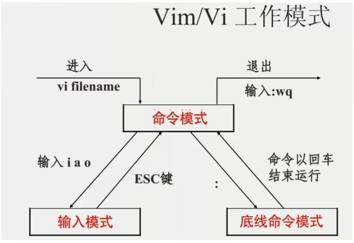
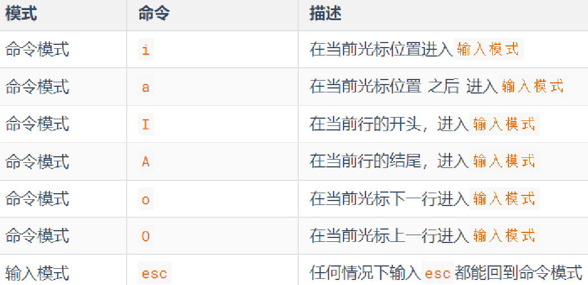
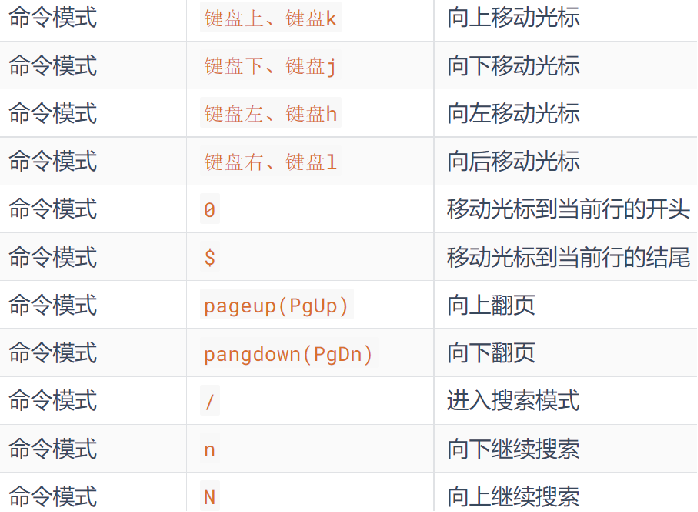
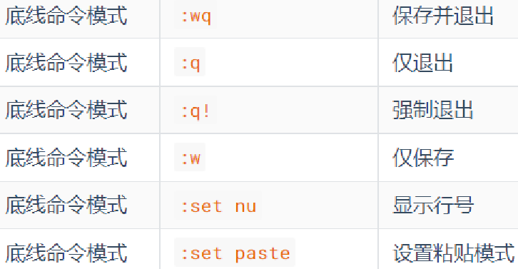
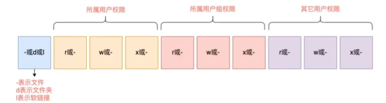
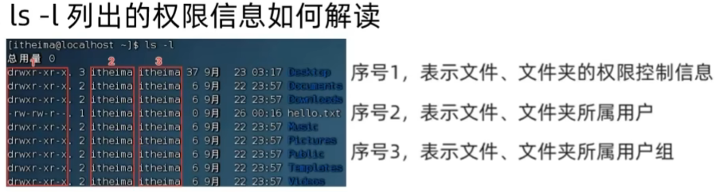
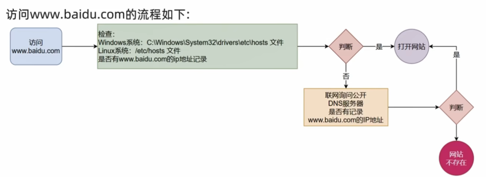
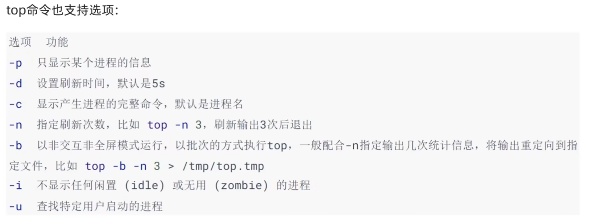

## 密码040131 ##
## 10.12.47.167:22（zzx / 040131） ##
查ip：ip -br addr

linux 没有盘符， 只有一个根目录 /

在win中，路径用\，如D:\home\zzx

在linux中，路径用/，如/home/zzx

命令格式:command [-options] [parameter]

###########################

ls命令

ls [-a -l -h] [linux路径]

ls:展开当前工作目录下的文件夹

ls -a :列出全部文件包括隐藏的

ls -l :以列表展开文件夹

ls -a-l   ls -al   ls -la 三种写法一样

ls -h :列出文件大小(跟着l一起用)

###########################

cd：切目录

pwd：打印当前工作目录

cd直接切回home，无需加路径

.   当前目录

..  上一级目录

~   home目录

###########################

绝对路径 ：cd /home/zzx/Test

相对路径 ：cd Test

###########################

mkdir 创建新的目录(文件夹)

语法：mkdir [-p] linux路径

        -p可选，表示自动创建不存在的父目录

touch 创建文件(文件，而非文件夹)

语法：touch linux路径

cat 查看文件内容(直接将内容全部显示出来)

语法：cat linux路径

more 查看文件内容(支持翻页)

ctrl+l ：清屏

###########################

cp:复制文件或文件夹

        cp [-r] linux路径1 linux路径2
        -r：复制文件夹
        linux路径1：复制的文件或文件夹
        linux路径2：复制到的地方

###########################

mv:移动文件/文件夹
        mv linux路径1 linux路径2
###########################

rm：删除文件/文件夹
        rm [-r -f] 参数1 参数2....参数N
        -r:删除文件夹
        -f:强制删除
        参数：文件/文件夹路径

通配符*：

        test* : 匹配任何以test开头的内容
        *test : 匹配任何以test结尾的内容
        *test* : 匹配含有test的内容

########################################

which:查找命令文件存放的位置
        如 which pwd ---- /usr/bin/pwd

find:按文件名查找文件/按文件大小搜索文件(可结合通配符)
        find 起始路径 -name "文件名"
        find 起始路径 -size +或-n[KMG]
                +/-代表大于或小于，n表示大小数字，KMG表大小单位
                如 find / -size -10k  查找顶层目录下小于10kb的文件      
#######################################

grep:从文件中通过关键字过滤文件行

        grep [-n] 关键字 文件路径
        -n:可选，表示在结果中显示匹配的行的行号
        关键字：表示过滤的关键字，带有空格或其他特殊符号
        如： grep "zzx" test1.txt

######################################

wc：统计文件的行数，单词数量等

        wc [-c -m -l -w] 文件路径
        -c:统计bytes数量
        -m:统计字符数量
        -l:统计行数
        -w:统计单词数量
        如：wc test1.txt   结果  2  3 17 test1.txt(行/单词/字节)

##########################################

管道符:将管道符左边命令的结果，作为右边命令的输入

        如：cat test1.txt | grep zzx(原为 grep "zzx" test1.txt )
            cat test1.txt | wc -l
            ls | grep zzx
            cat test1.txt | grep zzx | grep z

#############################################

echo : 在命令行内输出指定内容

        echo "输出的内容"
        如 echo "hello linux"   类似print

#########################################

反引号 `
        
        类似转义符
        如 echo `pwd` 输出结果为pwd的结果，而非输出pwd

#########################################

重定向符
        > 将左侧命令的结果，覆盖写入到符号右侧指定的文件中
        >> 将左侧命令的结果，追加写入到符号右侧指定的文件中
        如 echo "hello" > test1.txt
           echo "hello world" >> test1.txt
        
#############################################

tail命令

        查看文件尾部的内容，跟踪文件的最新更改
        tail [-f -num] linux路径
        -f : 表示持续跟踪
        -num : 表示查看尾部多少行，不填默认十行

#############################################

head
        
        查看文件头部内容
        head [-n] linux路径
        -n : 查看的行数

############################################

vi编辑器

        命令模式

                (vi)vim 文件路径。文件存在则编辑此文件，文件不存在就创建新文件
                
                常见快捷键：

       
        底线命令模式
        

#############################################

su [-] [用户名]
        
        如 su - root /sudo - i 切换至root

sudo  临时授权root

        如 sudo 其他命令 ：可为这一条命令临时赋予root权限 

退出用exit

###############################################

用户组

        groupadd 用户组名： 创建用户组
        groupdel 用户组名： 删除用户组
用户

        创建用户：
        useradd[-g -d]用户名
        -g 指定用户的组，不指定-g，会创建同名组并自动加入，指定-g需要组已经存在，如果已经存在同名组，必须使用-g
        -d 指定用户home路径，不指定则默认/home/用户名

        删除用户：
        userdel[-r] 用户名
        -r 删除用户的home目录，不使用-r删除用户时home目录保留

        查看用户所属组：
        id[用户名]
        若不提供参数用户名，则查看自身

        修改用户所属组：
        usermod -aG 用户组 用户名
        将指定用户加入指定用户组 

        查看用户
        getent passwd 
        结果 用户名：密码(x)：用户id：描述信息(无用):home目录:执行终端(默认bash)

        查看用户组
        getent group

##############################

查看权限 : rwx

        r:读            如ls
        w:写            如创建删除修改
        x:执行          如cd

        查看权限 ：ls -l,具体权限看后三位
        如 drwxr-xr-x  91 root root    4096 Oct 21 11:20 etc 

##############################

修改文件/文件夹权限信息 : chmod

        chmod [-R] 权限 文件/文件夹
        -R 对文件夹内的全部内容应用同样的操作        
        如 chmod u=rwx,g=rx,o=x test.txt   将文件权限修改为:rwxr-x--x
           chomd u=rwx,g=rx,o=x test       将文件夹test以及文件夹内全部内容权限设置为rwxr-x--x
                u表user
                g表group
                o表other
        快捷写法：chmod 751 test.txt
                0:无权限 1:x 2:w 3:wx 4:r 5:rx 6:rw 7:rwx
                751代表rwxr-x--x

###############################

修改文件/文件夹的所属用户和用户组 ：chown(root执行)

        chown [-R] [用户][:][用户组] 文件/文件夹
        -R：对文件夹内的全部内容应用相同规则
        如 chown root:zzx test.txt  将test.txt的所属用户修改为root,用户组修改为zzx

####################################

history:查看历史输入过的命令

        如：history | grep ch,过滤一下，筛选出含ch的命令

!命令前缀:自动执行上一次匹配前缀的命令

        如：!p ,会自动匹配上一次以p开头的命令并执行，如执行python

ctrl + l / clear 清屏

########################################

yum : RPM包软件管理器，用于自动化安装配置linux软件，并可以自动解决依赖问题(root)

        yum [-y] [install | remove | search] 软件名称
        -y:自动确认       安装 卸载 搜索 
        CentOS系统

apt：Ubuntu系统

        apt [-y] [install | remove | search] 软件名称

#############################################

systemctl命令:控制内置软件服务的启动/关闭/开机自启动等状态

        systemctl start|stop|status|enable|disable 服务名
        能够被systemctl管理的软件称之为服务
        服务举例:
                NetworkManager:主网络服务
                network:副网络服务
                firewalld：防火墙服务
                sshd:ssh服务

#####################################################

软链接: 

        ln -s 参数1 参数2
        -s:创建软链接
        参数1：被链接的文件/文件夹
        参数2：要链接去的目的地
        如：  ln -s /etc/yum.cof ~/yum  (其中~代表home)

#######################################################

date命令:在命令行中查看系统时间

        date [-d] [+格式化字符串]
        -d : 按照给到你字符串显示日期，一般用于日期计算
        格式化字符串 ： 通过特点字符串标记，控制显示的日期格式
        如： date "+%Y-%m-%d %H:%M:%S"    2026-10-23 18:33:11

###########################################################

hostname : 查看主机名

        hostnamectl set-hostname 新名字:修改主机名

域名解析

ip地址

        特殊ip：127.0.0.1  表示本机
        0.0.0.0 也可表示本机

###########################################################

网络请求

ping

        ping [-c num] ip或主机名
        -c 检查的次数，不指定则无限检查 

wget 

        wget [-b] url
        -b 后台下载，将日志写入到当前工作目录的wget-log文件中
        url 下载链接

curl ： 发送http网络请求，可用于下载文件获取信息等

        curl [-O] url
        -O 用于下载文件，当url是下载链接时，可以用此选项保存文件
        url  要发起请求的网络地址
        如：
                curl cip.cc  查看自己的ip信息
                curl baidu.com

#############################################################

端口

        公认端口：1-1023
        注册端口：1024-49151
        动态端口：49152-65535
        nmap ip ： 查看指定ip的对外暴露端口
        netset -anp|grep 端口号 : 查看本机指定端口号的占用情况  

################################################################

进程

        ps [-e -f]:查看linux的进程信息
        -e : 显示出全部的进程
        if : 以完全格式化的形式展示信息(展示全部信息)
        一般来说固定用法 ： ps -ef 列出全部进程的全部信息
        ps -ef | grep tail ：筛选出含tail的进程信息
        kill [-9] 进程id : 关闭指定进程
                -9 代表强制关闭 

###################################################################

top：系统资源监控

        查看cpu，内存等使用情况

df ： 磁盘信息监控

        df [-h]
        -h 以更人性化的单位显示

iostat [-x][num1][num2]  查看cpu/磁盘的相关信息   root命令

        -x 显示更多信息
        num1 刷新间隔
        num2 刷新次数

sar ： 网络监控

        sar -n DEV num1 num2
        -n 查看网络 
        DEV 查看网络接口
        num1 刷新间隔
        num2 刷新次数

############################################################################

$ : 取变量的值

        echo $PATH ： 取得PATH这个环境变量的值并通过echo语句输出
        echo ${PATH}abd : {}的作用是指定$符的作用对象

自行设置环境变量(好复杂)

        临时设置 export 变量名 = 变量值
        永久生效 
                当前用户 配置 ~/bashrc文件
                所有 用户 配置 /etc/profile文件

env ： 查看当前系统配置的环境变量信息

##############################################################################

压缩/解压

tar压缩

        tar [-c -v -x- f -z -C] 参数
        tar无文件大小压缩，gzip模式可以压缩
        -c 创建压缩文件，用于压缩模式
        -v 显示压缩、解压过程，用于查看进度
        -x 解压模式
        -f 要创建的文件或要解药的文件，-f必须在所有选项中位置处于最后一个
        -z gzip模式，不使用-z就是普通的tarball格式
        -C 选择解压的目的地，用于解压模式
        如：   
                tar -cvf test.tar 1.txt 2.txt 3.txt   将1.txt 2.txt 3.txt压缩到text.tar文件内
                tar -zcvf text.tar.gz 1.txt 2.txt 3.txt    将1.txt 2.txt 3.txt压缩到text.tar.gz文件内，使用gzip模式

                注: -z选项如果使用的话一般处于选项位的第一个
                    -f选项必须在选项位的最后一个

tar解压

        tar -xvf text.tar -C /home/zzx   解压text.tar 并放至/home/zzx中
        tar -zxvf text.tar.gz -C /home/zzx 以Gzip模式解压

zip 

        zip [-r] 参数
        -r 被压缩的包含文件夹时需要用-r

unzip解压

        unzip [-d] 参数
        -d 指定要解压去的位置
        如 uxnzip text.tar -d /home/zzx